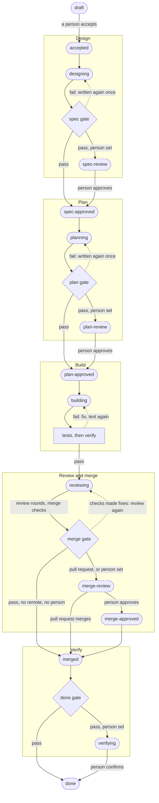
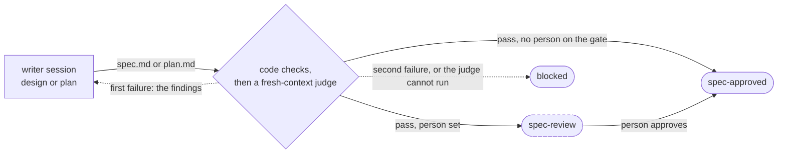
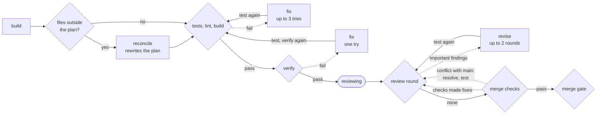
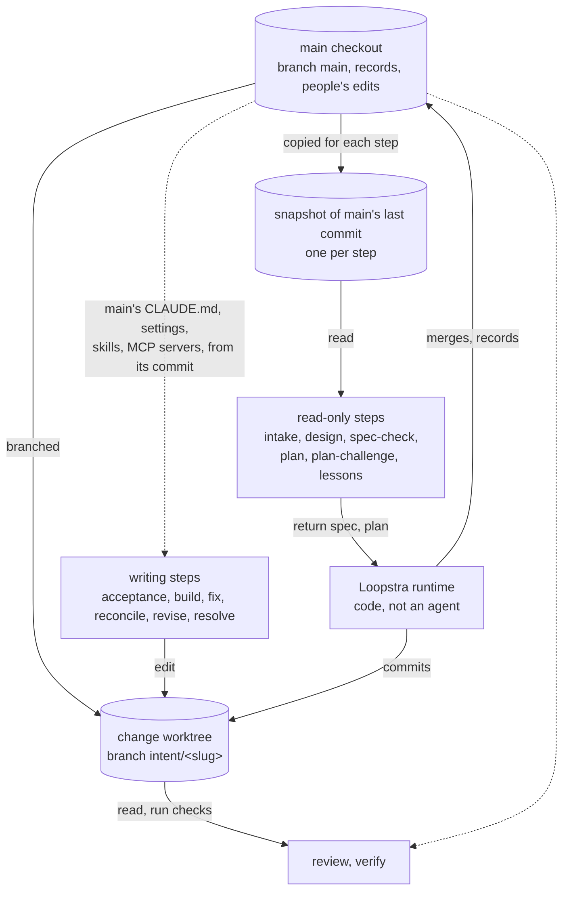
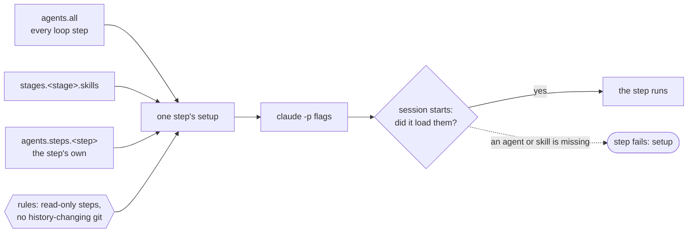
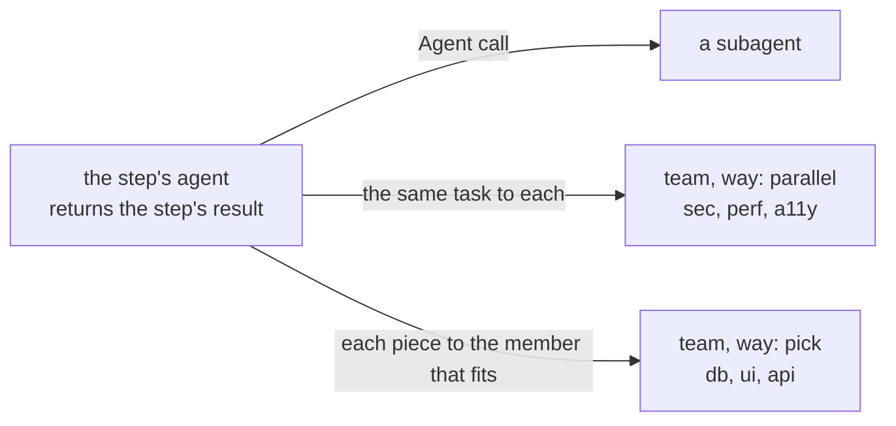

# Loopstra

[](https://github.com/jflavan/loopstra/actions/workflows/ci.yml?query=branch%3Amain)
[](https://www.npmjs.com/package/loopstra)

An unattended development loop built on Claude Code. Code owns the loop; agents own bounded phases; people own the decisions they choose to keep.

A product owner writes a plain-language `intent/<slug>/intent.md` and sets its status to `accepted`. Loopstra then designs, plans, builds, tests, reviews, merges and verifies the change, one step per change at a time, for up to `speed.max_parallel_changes` changes at once, with a gate at every stage boundary. Every artifact is a Markdown file in git, and every step is recorded in a trace you can read from a terminal or a local console. Instead of writing the intent by hand, you can also talk a change through with Loopstra's orchestrator in the terminal, the console, Slack or Discord; it writes the intent up for you as a draft (see Chat).

There are two audiences and two surfaces:

- **Engineers** configure the machinery once: test command, gates, prompts, limits. All of it is in `loopstra/config.yaml`, plus any prompt they customize in `loopstra/prompts/`, and, if they want them, the rules every change is held to in `loopstra/standards/` (see Standards).
- **Product owners** only write plain markdown (the intent) and a status line, or talk to the orchestrator in chat. Notes addressed to them are plain sentences with retry advice, never commands, branch names or raw output.

## Requirements

- [Bun](https://bun.sh) 1.4.4 or later
- git 2.28 or later (2.38 or later to keep a change that waits for a person mergeable while main moves on; see Conflicts with main)
- Claude Code CLI (`claude` on PATH), signed in with a subscription. Loopstra drives the CLI, not the API, so no API key is needed.
- GitHub CLI (`gh`), signed in, when the repo has a remote. `loopstra start` refuses to run otherwise.
- Optional, for chat on Slack or Discord: a Slack app or a Discord bot of your own (see Chat).

Windows, macOS and Linux are all supported; see Platforms.

## Quickstart

**Install** Loopstra once, from npm:

```
bun add -g loopstra
loopstra --version
```

**Set up a repository**, at its top folder, on the branch the loop should work on (usually `main`):

```
cd your-repo
loopstra init                 # writes loopstra/config.yaml, the stamp, the owner's guide and the skill
loopstra setup                # budgets, commands, gates, GitHub, chat, models, agents, standards (init offers it at the end)
git add -A && git commit -m "Set up Loopstra"
loopstra start                # runs the loop; watch it with loopstra status or loopstra ui
```

Then ask for a change: talk it through with `loopstra chat`, or write `intent/<slug>/intent.md` from the template in `intent/README.md` (see Ask for a change).

**Upgrade** to the latest release, in each repository that uses Loopstra, with its loop stopped (Ctrl-C in the loop's terminal):

```
cd your-repo
loopstra upgrade --check      # optional: what would change, writing nothing
loopstra upgrade              # installs the latest Loopstra, then brings this repository up to it
loopstra start
```

`upgrade` installs the new release once for the whole machine, and then updates the repository it runs in: Loopstra's files there are updated (your edits merged in), the config is migrated, and it all goes in one commit on `main_branch`, which the next `loopstra start` pushes. Run `loopstra upgrade` in each of your other repositories too, with their loops stopped as well: the install is already done there, so it only brings that repository up to it. A loop left running in another repository would go on with its old code but the new prompts until it is restarted. `loopstra start` and `loopstra status` tell you when a newer release is out. See Upgrade for what it changes and when it refuses.

**Coming from a source checkout** (`bun link`): run `bun unlink` in the checkout, install from npm as above, then run `loopstra upgrade` in each repository. Their first upgrade removes the prompt copies and the hook that older versions of `loopstra init` wrote into them (edited prompts stay, as your own), and `loopstra start`, `chat` and `ui` refuse in such a repository until that is done.

## Install

Loopstra is installed once, globally, from npm:

```
bun add -g loopstra
loopstra --version
```

`bun add -g` puts a `loopstra` command on your PATH (in `~/.bun/bin`; make sure that folder is on PATH). `npm i -g loopstra` works too, as long as `bun` is on PATH: Loopstra runs on Bun either way. `loopstra upgrade` always installs with `bun add -g`, and says so when another `loopstra` (an npm install, say) comes first on PATH. `loopstra help` lists the commands.

The runtime, the prompts and the test-protection hook stay in the installed package; a repository only gets its config, a few files it keeps (see Set up a repo) and any prompt it customizes. To move to a newer release, run `loopstra upgrade` in a project repository (see Upgrade). To work on Loopstra itself, see Develop Loopstra.

## Set up a repo

```
cd your-repo
loopstra init
```

`init` needs a git repository (outside one it says "This folder is not a git repository; run git init first." and writes nothing), and runs at its top folder: Loopstra works on a whole repository, so in a folder below the top (a package in a monorepo) `init` names the top and writes nothing, and `start` refuses there too. Set the commands to run in the package instead (for example `cd packages/app && bun test`). It is deterministic and never overwrites a file that already exists. It detects your test, lint, build and run commands (for a Node project with the package manager its lock file names: bun, pnpm, yarn or npm; a Python project with a `uv.lock` runs `uv run pytest`) and writes:

- `loopstra/config.yaml`
- `loopstra/stamp.json`: the Loopstra version the repository is on, and the shipped text each file Loopstra keeps up to date came from (see Upgrade)
- `intent/README.md` (the owner's guide) and `intent/queue.md`
- `REVIEW.md` (what the reviewer looks for) and a Commands block in `CLAUDE.md`
- `.claude/skills/loopstra/` (an operator skill for drafting intents, reading status and unblocking)
- `.loopstra/` in `.gitignore`

It writes no prompts, no hook and no `.claude/settings.json`: the prompts and the test-protection hook come with Loopstra (see Prompts). In a repository set up by an older Loopstra (a config, prompt copies or the old hook, but no stamp), `init` writes no stamp and says to run `loopstra upgrade`, which brings the repository to this layout.

`main_branch` in the config is the branch the repository is on when you run `init` (for a detached checkout, git's `init.defaultBranch`, else `main`).

Then:

1. Run `loopstra setup`. In a terminal, `init` offers it at the end ("Walk through the settings now?"). It goes through every setting, one section at a time (budgets, commands, gates, GitHub, chat, models, agents, standards), showing the current value and a suggestion: Enter takes the suggestion, and `-` leaves an optional answer empty. A command left out with `-` stays out: its `# install:` line stays, and later runs do not suggest the detected command again. It saves `loopstra/config.yaml` once, at the end, keeping its comments; if you quit (Ctrl-D) or the result would not load, it saves nothing. Then it checks what it can for the sections it ran, all at the same time: that `claude` is installed, that `commands.test` passes on main (in a throwaway checkout, after `commands.install`; a program that is not installed fails, naming it), with a git remote, that it answers and `gh` is signed in (every change then goes through a pull request), that the Slack and Discord tokens work, that every agent the steps name is in place, and, when main has standards, that they read and that each one's tool check passes on main (see Standards). The agents section can also add skills and agents to the repository: from this machine's own, from a git repository or folder (copied as data, never run), or a new agent written from a short form. Those files are written after the config saves, only under `.claude/agents` and `.claude/skills` (and `loopstra/standards/`, from the standards section); setup never commits them, so commit them with the config. What is not ok is listed under "To fix", with the `loopstra setup <section>` to run again; it never undoes the save.
2. Commit everything `init` wrote, with the config as setup left it, on that branch. The loop works in its own checkouts, which only see what is committed, and `loopstra start` refuses until the config, the stamp and any prompt override (the `.md` files in `loopstra/prompts/`; anything else there is passed over) are committed. Commit the config again whenever setup changes it.
3. Start the loop with `loopstra start` (see Run).

`init` prints the same three steps. After the walkthrough it says what is left: commit and start, or, if setup saved nothing, run it again first.

`loopstra setup <section>` runs one section, for example `loopstra setup budgets`; `loopstra setup --help` lists them. `loopstra setup --defaults` takes every suggestion without asking (for scripts; it never adds a spending limit). `loopstra setup --check` changes nothing: it says whether the config loads, runs the checks, and exits 1 if the config does not load or any check fails. Without a terminal, plain `loopstra setup` refuses and says to use one of the two. Setup never calls Claude.

If every problem in the config is in a setting the sections being run ask about (say `commands.test`, or `gates: none`, which the gates questions replace), setup lists them in a note and the questions go on. An unknown key, or a problem in a setting no question asks about (like `claude.timeout_minutes`), is listed under "Fix these in loopstra/config.yaml first:", and setup asks nothing.

You can also open Claude Code in the repo and ask the `loopstra` skill to help you decide: it explains the choices and tells you which `loopstra setup` section to run. The skill never runs the loop.

## Ask for a change

Either talk it through in chat (see Chat), which writes the intent for you, or write it yourself:

Make `intent/<slug>/`, where the slug is lowercase words joined by dashes, like `add-numbers`. Copy the template from `intent/README.md` into `intent.md` inside that folder (a Markdown file loose in `intent/` is listed as unreadable, with how to fix it):

```markdown
---
status: draft
# priority: low, normal, high or urgent. Leave it out and Loopstra fills it in.
# depends_on: [another-change] (optional: changes that must be merged first)
author: Your name
opened: 2026-01-01
note: ""
---
# Intent: a short title

## Problem
## Proposed outcome
## Done when
## Affected users and systems
## Constraints
## Open questions
```

Write it in your own words. "Done when" is a list someone could check. When it is ready, change `status: draft` to `status: accepted`. That is the only step a person must always take. Saving the file is enough; you do not need to commit it.

One change gets one spec, one plan and one build session, within `timeout_minutes` (and `max_budget_usd`, if you set one). Split larger work into several changes. When a change needs another to be in main first, list it under `depends_on`: the change is not started (or continued) until each one it names is in main: `merged`, `verifying` or `done`, or blocked or closed after it merged. A blocked dependency keeps it waiting, and `status`, `queue.md` and the console say which change it waits for. A name that matches no change, a change closed before it merged, or two changes that wait for each other shows under "Needs attention".

Problem, Proposed outcome and Done when are required. An accepted request without them is blocked at once with a note like "This request is missing a Proposed outcome and a Done when section. Add them to intent.md, then set status to accepted."

## Run

```
loopstra start          # the loop; one step per tick for each change it runs, sleeps poll_seconds between ticks
loopstra start --once   # one tick, then exit (for cron or a scheduler)
```

`start` checks that the folder is a repository's top and is set up (`loopstra/config.yaml` exists), that git and `claude` are installed, that you are on `main_branch`, that Loopstra's own files are committed, and (with a remote) that `gh` is signed in. It prints a plain message and exits if any is not true. In a folder below the top it names the top to run in. In a repository set up by an older Loopstra it says to run `loopstra upgrade` first, and so do `chat` and `ui` (see Upgrade). It refuses when a loop is already running in the repository (if none is, delete `.loopstra/loop.lock` and `.loopstra/heartbeat.json`, then start again); loops in different repositories run side by side, since one install serves them all (give the second `loopstra ui` its own `--port`). `status`, `tail`, `judges`, `ui`, `chat`, `setup`, `upgrade` and `customize` in a folder that is not set up say "This folder is not set up for Loopstra. Run loopstra init first." and create nothing.

The loop never dies on a bad edit or a failed step; the problem is traced and the next tick comes. It runs one change at a time, or, with `speed.max_parallel_changes` above 1, up to that many changes at once, each still one step at a time (see How it works).

**Stopping.** Press Ctrl-C once to stop gracefully: nothing new starts, a running session is killed, and the change keeps its in-progress status and resumes on the next start. Press Ctrl-C a second time to exit at once; any process Loopstra started that is still running (a session, a project command, git) is killed with everything it started. SIGTERM does the same as Ctrl-C, and so does closing the terminal (SIGHUP) on macOS and Linux.

**From cron or a scheduler.** Run `loopstra start --once` from the repository, with an explicit PATH: cron's is short and usually lacks `~/.bun/bin` and wherever `claude` is installed. For example:

```
*/10 * * * * cd /home/me/your-repo && PATH=/home/me/.bun/bin:/home/me/.local/bin:/usr/local/bin:/usr/bin:/bin loopstra start --once >> .loopstra/cron.log 2>&1
```

The PATH must reach `bun`, `git`, `claude` and (with a remote) `gh`. Loopstra also puts the folder of the `bun` it runs on first on the PATH of every session and project command it starts.

**When the assistant is unavailable** (signed out, usage limit, overload, network), nothing is blocked. The loop pauses and retries after 1, 2, 4, 8, 16, then 30 minutes, resetting after the next success on the model that failed (the cheap model getting through says nothing about the strong one's limit). The pause survives a restart (`.loopstra/paused.json`) and shows as "The assistant is unavailable ... Retrying at 14:32." in `status`, `tail` and the console; a stopped loop adds "the next start waits until 14:32". If it keeps pausing, check that `claude` works in a terminal. When the same step pauses three times in a row with the same message, the loop sends one tiny test request to the model that failed ($0.05 at most on the cheap model, $0.25 on another): if that gets through, the step's own failure blocks the change like a crash, so a step that only looks like an outage cannot pause the loop forever.

## Watch

```
loopstra status         # loop state, what needs a person, then every change: priority, where it is, last phase, cost, note
loopstra tail           # live events; `loopstra tail <slug>` for one change
loopstra ui             # the console at http://127.0.0.1:4646 (--port <n>), with the orchestrator (see Chat)
loopstra judges         # how often the cheaper judges agreed with the strong ones (speed.cheap_judges)
loopstra retro          # how the loop did over the last 7 days, and what to change (--days <n>)
```

`loopstra retro` reads the trace back and reports on a window of days (7 unless `--days` says otherwise): which changes reached main, finished, blocked or were closed, and how long a change took from accepted to merged; where changes blocked, grouped by why (timed out, tests kept failing, the reviewer kept finding problems, checks on GitHub failed, and so on); each gate check, how often it ran and how many changes passed it the first time; what the loop spent, by kind of step, with chat on its own line; and how long changes waited for a person at each review status and for answers to questions. It ends with suggestions, each naming its evidence and the setting to change: more fix loops or review rounds, a longer timeout, a higher session limit, trying the cheaper judges or letting them go first, or taking a person off a gate whose checks always pass while changes wait on them for days. It only reads; changing a setting is up to you.

The loop line reads Running, Paused, Stopping, Stopped, "Stopped — it did not shut down cleanly" (the loop process is gone: killed or crashed; start it again), or "Not responding" (the process is there but has not checked in: hung, or the machine slept).

Under it, `status` prints a "Needs attention" block, or "Nothing needs you right now.": a pause, failing tests on main (before main has ever passed, that they have not passed yet), main out of step with GitHub, GitHub not answering about pull requests for 15 minutes while a change waits on its pull request (gh signed out, say, or a token GitHub no longer takes; until it answers again, or no change waits on one), a settings problem, a standard on main that cannot be read and lines of a change's `standards.md` that do not read (see Standards), blocked changes, unreadable intents, and changes waiting for a person (drafts, reviews with a person on the gate, and a spec or plan whose exception to a standard waits for a person: "Waiting for you: exception to ARCH-1"). The console's inbox shows the same list, labelled "Blocked" or "Waiting for you". Long notes wrap to the terminal's width.

The console is one local web app that updates live over one stream from the server (Spend and the chat drawer refresh on their own; about 35 KB of script):

- **Live:** a card for every agent running now: its change, step and model, a running clock and an estimated cost (marked `~`; the real cost is recorded when the step ends), what it is doing ("Running bun test", "Editing src/csv.ts") and its recent activity. Under the cards, what is up next and why it waits, and the steps that just finished.
- **A session:** an agent's transcript as it happens: what it wrote, each tool call (open one to see its input and output), each edit as a diff, and how it ended, with its todo list, cost and files beside it.
- **Inbox:** everything that needs a person, the same list as `status`. <kbd>J</kbd> and <kbd>K</kbd> move through it, <kbd>O</kbd> opens a change.
- **Changes:** a board with a column per stage (or a list; changes done over a week ago fold away below it with the closed ones), and a page per change: its note and intent, its documents (rendered, read-only), a timeline of its steps with what each cost and any commands it was refused, its code (the branch's diff against main), and its gate results with their evidence.
- **Activity:** what happened, in plain words, or the trace's technical events.
- **Agents:** every active agent at once, a tile each: its live transcript (scroll up to read back; edits show as counts), and a one-line box to message, redirect or stop it without leaving the grid. Agents waiting on your answer come first, with Answer. A session that finished stays a minute, greyed, so it does not vanish while you type to it. The orchestrator has a tile too, and the speech button on an agent's tile asks it about that agent. Live's Watch and Message open the agent's tile, and the tile's corner button opens its full session page. One stream carries every tile, however many agents run. <kbd>G</kbd> <kbd>W</kbd> goes there.
- **Spend:** today, this week and all time, by change, by kind of step and by hour, and the cheaper judges' record.

The orchestrator is a drawer on every screen (Ctrl J; see Chat); opened from a change or an inbox item, it is told what it is about. Ctrl K searches changes, agents and commands; `?` lists the keys. The tab's title counts what needs you (the icon shows a dot), and the palette can turn on browser notifications, which come only for what a person must act on (blocked or waiting) and only when the tab is in the background. If the connection drops, the page reconnects and catches up on what it missed; after 20 seconds of silence it says "Reconnecting…". The console listens only on 127.0.0.1 and answers only to 127.0.0.1, localhost and [::1]; the page carries a Content-Security-Policy with no inline script, and Markdown shows only http(s) and relative links. `queue.md` in `intent/` is a generated view of the same queue; its "Needs a person" list matches. The console follows the system's light or dark theme (the moon button switches it), its text scales with the browser's text size, and it respects the system's settings for reduced motion, reduced transparency and more contrast.

**Acting from the console.** On a change's page and in the inbox you can approve, send back with a note, retry, start, hold, release, set the priority of and close a change, and the top bar pauses or resumes the loop. Pause and Resume write `.loopstra/hold.json`; every other button leaves a request in `.loopstra/requests/`, and the loop applies it within a couple of seconds, even while steps run, and commits it like an edit of `intent.md` (`loopstra(<slug>): plan approved by <name> from the dashboard`). A status change is refused when the change moved on since you looked; priority, hold and release apply to any open change. The toast that says how it went offers Undo for a few seconds (approve, send back, priority and hold; close asks first instead). A held change keeps its place, but the loop starts no step for it until it is released; a paused loop lets running steps finish and starts no new one. Chat can do the same after a plain yes, and editing `intent.md` still works.

**What a session ran as.** A session's page lists, among its facts, the agent setup the step ran with, from the trace's `agent_setup` event: the agent (or "none"), its subagents (with the model each was given, if any), teams with their members (and models), skills, tools, MCP tools, and "repo only" when only the repository's own agents and skills loaded. Empty lists are left out, and a session without that event (every session before the setup existed, or one with no setup) shows no such lines. When the agent hands work to a subagent, that work is nested under the call that started it (the row labelled "Handing off to <type>"), in a block that opens and closes: the prompt it was given, then its own messages and tool calls. A subagent's prompt is shown as the prompt it is, never as a message from you.

## Steering

You can steer an agent while it works, from its tile on Agents or from its session page (open it from a tile, or a change's timeline). Each has a box with three buttons (shorter on a tile, where Enter sends):

- **Send message.** The agent reads it at its next step, between two tool calls, and carries on. Ctrl+Enter (⌘+Enter on a Mac) sends it too.
- **Redirect.** The session stops what it was doing and starts again your way. It is the same session, so it keeps what it knew, and messages it had not read yet go along.
- **Stop session.** After a confirm, the session ends and the change is held, so it does not start again until someone releases it. The change's controls (on its page and in the inbox) have Stop too, for everything the change is running.

Only work sessions can be messaged or redirected: intake, design, plan, acceptance, build, fix, reconcile, revise and lessons. Checks (the spec check, the plan challenge, review, verify, the done-check and the cheaper judges) can only be stopped: a message would quietly change a gate. Approve or send back instead. A message that comes after its session has finished is kept for the change's next session.

**Questions.** An agent may ask you when a decision belongs to a person and there is no sensible default. Intake, design, plan, build and revise can ask; fix and reconcile carry on the build's session, so they never ask, and acceptance never asks either: the Done when list is the owner's answer already. The step ends, and the change waits with `question: open` in `intent.md`. It costs nothing while it waits. It shows as "Has a question" in Needs attention, `status`, `queue.md` and the console's inbox, with the question, why it asks, and any options. Chat announces it too.

Answer it with Answer, in the inbox or on the change's page. Or tell the orchestrator in chat; it asks you to confirm first, and only people who may act on changes can answer there. Or answer by hand: write your answer under the question in `conversation.md` and remove the `question:` line. On the change's next step, the agent that asked carries on with your answer. When it cannot (the change moved on meanwhile, or you answered by hand), the next session reads the answer in `conversation.md`.

An agent may ask at most 3 questions while the change stays at one status. After 3, its prompt says it may ask no more, and a 4th blocks the change.

**`conversation.md`.** Each change has `intent/<slug>/conversation.md`: what people told its agents (messages, redirects, answers, send-back notes, messages kept for the next session) and what the agents asked. The loop writes it and commits it. Every work session reads it, so what you said is not lost when a new session starts. You can read it, or edit it like any record.

## Chat

Instead of writing intents by hand and reading `status`, you can talk to Loopstra's orchestrator:

```
loopstra chat               # in the terminal (Ctrl-D or /quit to leave)
loopstra chat --no-terminal # only the Slack and Discord bots, for a server or a service manager
loopstra ui                 # the console has the same chat in a drawer (Ctrl J; --no-chat to leave it out)
```

Ask it how things are going ("what's blocked?", "what merged this week?") and it answers from the intents, `loopstra status` and the recent history of the main branch, which Loopstra hands it. Talk through something new and it asks what done looks like, who it affects, and whether it should be split. When you agree, it proposes a brief and asks "Shall I write this up as a pull request?". Only a plain yes from the person it asked goes ahead, within a day; anything else carries on the conversation. A separate writer, which sees only the brief, then writes one or more intents (with `depends_on` when it splits the work), Loopstra checks them the way the loop would, and:

- with a remote, they go up as a pull request on a branch `intent-proposal/<slug>`, made in a throwaway checkout (your main checkout is never touched). Merging it adds them to the queue as **drafts**, and chat says so in the conversation;
- without one, the loop adds them to `intent/` as drafts on its next tick.

Nothing starts until someone accepts a draft. You can still set `status: accepted` yourself, or ask in chat ("start csv-export"): Loopstra asks "Start work on csv-export now?" and, on a yes, leaves a request that the loop applies within a couple of seconds (`loopstra(<slug>): accepted by <name> from Slack`). If you changed the status yourself meanwhile, your edit wins. In the same way it can approve, send back with your note, retry, close, hold, release or set the priority of a change ("approve the plan of csv-export"): it checks the change can do that now, asks, and on a plain yes leaves a request the loop applies, then says how it went. A conversation that began before you upgraded keeps the instructions it started with, so start a new one to get these actions. Apart from that the orchestrator is read-only.

It also tells you things without being asked: each new "Needs attention" item (the same words as `status`), a change reaching the main code, a change done, and a chat pull request merged or closed. Bots post these to their `announce_to` channel; the terminal and the console show them while open.

One conversation goes on as long as you like and can hand off many times. Each chat turn and writer run is a Claude Code session on your subscription, traced under `_chat` (`loopstra tail _chat`); their cost counts in the console's totals. Chat has no spending limit unless you set one (`loopstra setup budgets`): then `chat.max_budget_usd_per_day` caps the day, of which one session may hold at most `chat.max_budget_usd_per_session`, so several conversations can run at once. The prompts are `orchestrator.md` and `write-intent.md`, shipped with Loopstra like the others (see Prompts).

**Slack and Discord.** Set them up with `loopstra setup chat`, at any time and in any mix: it writes `chat.transports` in `loopstra/config.yaml`, checks the channel and user ids, and checks that the platform accepts each token. Tokens are read from the environment variables the config names, never from the file; setup always writes those names (`token_env`, and Slack's `bot_token_env`), so the file says which variables to set. A new bot's announcements go to its channel unless you answer `-`. Each top-level message in the channel starts a conversation in its thread. `allow` lists who may chat (empty: anyone in the channel); `acceptors` who may also have a draft written up, start drafts and act on changes (empty: nobody from there). Both are read again for each message, so a change counts at once; a change to a token or channel needs `loopstra chat` restarted, and a bot taken out of the config ignores its messages until then. At the terminal and the console, which only listen on this machine, you always may. Put long numeric ids (Discord's) in quotes: as YAML numbers they lose digits, so Loopstra refuses them.

The orchestrator and the writer can read the repository's files, but not change anything, and have no git commands (Loopstra gives them the recent commit subjects itself, since `git show` could read any file's past content); they are also kept away from the usual places secrets live (`.env` files, keys, `~/.ssh`, `~/.aws`, `~/.config`, `~/.claude`, `~/.claude.json`, `~/.docker`, `~/.kube`, the shell's rc files, `/proc` and the like, by their absolute paths too), and the bot tokens the config names, with anything else named like a secret, are kept out of their environment (except what Claude Code itself signs in with: `ANTHROPIC_`, `CLAUDE_`, `AWS_`, `GOOGLE_`, `CLOUD_ML_` and `AZURE_` variables; a secret only an `apiKeyHelper` script reads from the environment is dropped too, so have the script read it from a file). That is a guard, not a sandbox: anyone who can chat can ask what the repository holds, so keep `allow` lists to people who may see it.

- Slack uses Socket Mode, so nothing needs a public address: an app-level token with `connections:write` and a bot token with `chat:write`, `channels:history` and `users:read`, with the `message.channels` event subscribed.
- Discord uses the gateway: a bot token, the Message Content intent turned on, and permission to read, send messages and create public threads in the channel. A token Discord refuses at start stops `loopstra chat` with a line naming the token's variable. When Discord refuses the token or the intent while it runs, `loopstra chat` says which, once, and tries again every 5 minutes, so fixing it needs no restart. Slack's app-level token is treated the same way.
- Both bots notice a connection that died without saying so (a laptop that slept, a router that forgot it): Discord by a heartbeat that gets no answer, Slack by a ping, after two quiet minutes, that gets no answer; either opens the connection again by itself.

## When something needs a person

The `status` and `note` lines at the top of `intent.md` say what to do; `intent/README.md` has the full table for owners.

- `blocked`: read the `note`. It says in plain words what went wrong and which status to set to try again (for example back to `plan-approved`), or you can set `closed`. A passing hiccup (the assistant crashed or took too long) says "To try again, set status to ..."; anything else says "When that is sorted out, ...". Loops are bounded (test-fix 3, review-revise 2). A step that hits its spending limit (`claude.max_budget_usd`, if set) blocks, and its note says an engineer can raise or remove it with `loopstra setup budgets`; so does a step that, on two days at the same status, used (nearly) the whole of the loop's daily budget itself and still ran out partway.
- `spec-review`, `plan-review`: the automatic checks passed and a gate is set to wait for a person. Read `spec.md` or `plan.md`, then set `spec-approved` or `plan-approved`, or say what is wrong in the note and set the earlier status. Stepping a review status never advances it.
- `merge-review`: checks passed and the change is waiting to go into the main code. Follow the note: with nobody on the merge gate it waits for the checks on GitHub (nothing to do; it merges once they pass, even while another change is being worked on, within about `poll_seconds`); with `pr`, approve the pull request on GitHub; with `status`, read `review.md` and set `merge-approved`. If other work merged meanwhile conflicts with it, it goes back to `reviewing` on its own ("Other work merged into main meanwhile conflicted with this change…") and comes back to you once the resolution is tested and reviewed; with `pr`, approve it again, since an approval from before the resolution does not count.
- `merge_gate: pr` or `merge_gate: status` beside `merge-review`: the change is risky (it touches files named under `gates.merge.risky`, or is larger than its `lines`), so it waits for a person even with nobody on the merge gate. Its note names up to three of the files. With `pr`, approve the pull request on GitHub (without a remote, there is none: set `merge-approved`); with `status`, read `review.md` and set `merge-approved`. Loopstra writes the line, and removes it, each time the change passes its merge checks; deleting it by hand takes the change back to the config's merge gate.
- `spec_gate: status` or `plan_gate: status` beside `spec-review` or `plan-review`: the spec or plan asks for an exception to a rule of the repository's standards, which only a person can allow, so it waits even with nobody on that gate. Its note names the rules and the reasons. Set `spec-approved` or `plan-approved` to allow them, or send it back with a note to have it written again without them. Loopstra writes the line, and removes it at the next pass that asks for none. Deleting it by hand does not allow the exception: the spec or plan is checked again and waits again (see Standards).
- `merged`: the change is in the main code.
- `verifying`: with a person on the done gate, look at the result and set `done`.
- `question: open`: an agent asked you something, and the change waits for your answer, whatever its status. See Steering.
- `outcome.md` may have "For a person to confirm": things the system could not check itself. They never hold a change up.

A person's edits win. If you change the status while a step is running, that step writes nothing and the next tick follows your status. Hand-editing a status cannot skip a stage: the artifacts it implies must exist.

## GitHub

With a remote, the approving review pushes the change's branch and opens a pull request instead of merging locally. What happens next follows `gates.merge.human`:

- `none`: merge when the PR's checks pass. A failed check or closed PR blocks.
- `pr`: also needs an approval on the PR (or a person setting `merge-approved`). When a branch rule requires reviews, GitHub decides whether the PR is approved. Otherwise Loopstra reads the reviews itself, and only those of the repository's owner, members and collaborators count (anybody can review on a public repository): one of them approving is enough, as long as none of their latest reviews asks for changes. That is broader than GitHub's own rule, which counts only people with write access, so a collaborator with read access counts here; for GitHub's rule, add a branch rule that requires approving reviews.
- `status`: a person sets `merge-approved`, and the PR's checks must pass.

**Risky changes.** Some changes should not go in unseen even when the rest merge on their own: changes to CI, dependencies or migrations. `gates.merge.risky` names them:

```yaml
gates:
  merge:
    human: none
    risky:
      paths: [".github/**", "package.json", "bun.lock", "**/migrations/**"]
      lines: 1500   # optional: more lines added and removed than this is risky too
      human: pr     # or status; pr is the default
```

A change is risky when a file it changes (outside `intent/`, new or old name of a renamed file) matches one of `paths`, or when its lines added plus removed, outside `intent/` and not counting binary files, are more than `lines`. Patterns are globs on repository paths with `/`: `package.json` matches only at the top, `**/package.json` anywhere. With nobody on the merge gate, a risky change waits in `merge-review` for `risky.human` (`pr`: an approval on GitHub, or `merge-approved`; without a remote, `merge-approved`), and Loopstra writes `merge_gate:` in its `intent.md` (see When something needs a person). When the config already has a person on the merge gate, that person decides as before, and only the trace says the change was risky. The decision is made each time the change passes its merge checks, on the code that will merge, so a fix or a rebuild is scored again; commits a person pushes to the pull request are not. The trace has it as the merge gate's `risk` check: `pass` ("nothing risky"), or `waiting` with the files that matched and the size. Nothing is risky until `paths` or `lines` is set; `loopstra setup github` asks for `paths` when nobody is on the merge gate, suggesting `.github/**`, `**/migrations/**` and the dependency and build files at the top of the repository (`--defaults` never adds a list).

Merges go through `gh pr merge`, never twice, and only at the commit whose checks were read (`--match-head-commit`): commits pushed to the PR after that are taken into the branch here and merge once their own checks pass, and so does a PR someone updated on GitHub with "Update with rebase". A PR that is merged or closed on GitHub is noticed in any mode; a draft waits until it is marked ready for review. A PR someone merged by hand while a later review round committed fixes blocks, naming the branch, rather than record the fixes as merged. Loopstra knows each build's own PR by its number: a PR a person closes stays closed (the change blocks, also when it was being reviewed again), and a rebuild opens a new PR rather than taking an earlier build's merged or closed one for its own. Loopstra waits while any check is still running, and blocks when any fails or is cancelled. A PR with no checks at all merges; if the branch has workflows under `.github/workflows/`, it first waits up to 5 minutes after the PR opens or Loopstra pushes to it, for GitHub to start them. Pull requests are watched while other changes are worked on: each tick looks at them as its steps start, again every `poll_seconds` while any step runs, and once more when the last has ended, so a PR whose checks pass during another change's long build merges then, not after it. Just before `gh pr merge`, at every `speed.max_parallel_changes`, one included (the watcher may merge one PR while the lane works on the next change), Loopstra checks that the PR still has everything on `main`: a PR another merge left out of date is brought up to date, pushed, and waits for GitHub's checks again, so two changes never reach `main` together untested. After a merge, Loopstra deletes the branch on GitHub and keeps the local one until `main` has the change. The change is recorded as merged, and its done-check runs, only once local `main` has the PR's merge commit; until the sync can bring it in (for example while the main checkout has unsaved changes), the change waits, and the console and `loopstra status` say that its PR merged and why `main` here does not have it yet (the `main_sync` signal's reason). They also say when a PR waits for GitHub to merge it (a merge queue), or is ready but waits for `main` here to take what GitHub merged meanwhile. Without a remote the same checks run and Loopstra merges locally.

Each tick, and right after a PR merges, Loopstra fetches and brings local `main` up to date with the remote's: commits only local `main` has are replayed on top of the remote's `main` in a throwaway copy (`.loopstra/sync`), and then the main checkout moves to the result in one step. The main checkout is never left in the middle of a rebase, even if Loopstra is killed; a move that a kill cuts short is put back as it was before the next tick does anything else. It shares `main` once, at the end of the tick (and just before it pushes a change's branch for its pull request), and only when every unpushed commit is its own (bookkeeping under `intent/`). Your own unpushed commits are never pushed for you; it waits until you push them. In `intent/`, the remote's version wins.

Loopstra's bookkeeping commits on `main` (`loopstra(<slug>): ...`) end with `[skip ci]`, so they do not start CI; the change's own merge commit does. `intent/queue.md` is rewritten every tick but committed only along with another of Loopstra's commits, so a quiet tick adds no commit; an unsaved `queue.md` never holds up a merge or the sync.

## Lessons

When a change is verified, Loopstra writes `intent/<slug>/lessons.md` for engineers: what was learned and proposed additions to `CLAUDE.md`. To adopt them:

```
loopstra apply-lessons <slug>
```

This copies the bullets under "Proposed CLAUDE.md additions" into a `## Lessons` section of `CLAUDE.md`, skipping any already there. Review the diff and commit it.

## How it works

A change moves through five stages. Each stage runs a few steps, each step is one Claude Code session, and a gate at the end of the stage decides whether the change moves on. A person always accepts a change (`draft` to `accepted`); by default nobody has to do anything after that.



Rounded boxes are statuses; the Steps table below says which steps run in each stage. The dashed ones wait for a person, and the review statuses appear only when a person is set on that gate (see When something needs a person); with nobody set, a passing gate goes straight on. Dotted arrows go back for another try, within the limits below. Any status can also go to `blocked` or `closed`. The step called `verify` belongs to the build stage, where it runs the finished change's checks; the Verify stage runs `done-check` and `lessons` after the merge.

### Steps

Each step is one session, with its own prompt (see Prompts), model (see Models for each step) and, if you set one, agent setup (see Agents for each step).

| Step | Stage | What it does | What it may do |
| --- | --- | --- | --- |
| `intake` | design | reads a new intent, and sets its priority when the owner gave none | read |
| `design` | design | writes the spec | read (plan mode) |
| `spec-check` | design | judges the spec | read |
| `plan` | plan | writes the plan | read (plan mode) |
| `plan-challenge` | plan | judges the plan | read |
| `acceptance` | build | writes tests from "Done when" before the build (with `stages.build.acceptance_tests`) | edit tests and test fixtures only, and run commands |
| `build` | build | writes the code | edit, and run the project's commands |
| `reconcile` | build | rewrites the plan when the build changed files it did not list | edit, and run commands |
| `fix` | build | fixes failing checks, or a failed verify | edit, and run commands |
| `verify` | build | runs the checks and reads what they show | read, and run commands |
| `review` | review | reviews the code | read, and read-only git (`diff`, `log`, `show`, `status`) |
| `revise` | review | fixes the review's important findings | edit, and run commands |
| `done-check` | verify | judges whether the change did what "Done when" says, on a copy of `main` | read, and run commands |
| `lessons` | verify | writes `lessons.md` | read |
| `orchestrator` | chat | talks with you (see Chat) | read |
| `write-intent` | chat | writes an agreed brief up as intents | read |

"Run the project's commands" means the configured test, lint, build, run and install commands; build sessions also get `claude.allowed_tools`, and the tool checks of the standards that apply (see Standards). With standards, `design`, `spec-check`, `plan`, `plan-challenge`, `build`, `resolve`, `review` and `done-check` are also given the standards that apply, with what to do with them.

### Gates

Gates sit at every stage boundary. Each is a list of checks: deterministic code, a fresh-context agent reviewer, or a person. A gate's checks run in the step that produced the artifact; a pass goes straight to the approved status, or to the review status if a person is set. A failure gets one automatic rewrite with the findings, then blocks.



The spec gate is drawn; the plan gate has the same shape. The merge and done gates run their checks the same way, but a failure is not written again:

| Gate | Its checks | A person can be | When it fails |
| --- | --- | --- | --- |
| `spec` | the required headings; with standards, a Standards section that names only real rules; the `spec-check` judge | `none` or `status` | written again once with the findings, then blocked |
| `plan` | the required headings; every file it lists exists or is new; with standards, a Standards section that covers every rule that applies; the `plan-challenge` judge | `none` or `status` | written again once with the findings, then blocked |
| `merge` | with standards, the change does not edit them; the branch is up to date with `main`, the tests pass, then the tool checks of the standards that apply, and the newest review has no important findings | `none`, `status` or `pr` | fixes the checks had to make go back to review; anything else blocks |
| `done` | the `done-check` judge, against "Done when" and each rule of the standards that applied | `none` or `status` | unmet criteria or rules block, and `outcome.md` lists them |

### Build and review



**Acceptance tests** (`stages.build.acceptance_tests`; on in repos set up with `loopstra init`, off in older ones until you set it). Before the build session, a fresh `acceptance` session in the change's worktree writes tests from the owner's "Done when" list, in the project's own test style and folders, and runs them (they should fail, since nothing is built yet). The protect-tests hook lets it edit only tests and test fixtures. The runtime commits them on the branch (`loopstra(<slug>): acceptance tests`) and records `intent/<slug>/acceptance.md` on `main`: each test under the criterion it covers, and the criteria no test can check, with why. From then on, build, fix, reconcile and revise (the merge checks' fixes too) may not edit those files: the hook refuses, and if the session then fails, the block note names the file and says an engineer can fix it on the branch. The drift check leaves them out, so they never start a reconcile. The step runs once per build: a build resumed after a stop keeps what it wrote, and a new build (from `plan-approved`, or a send-back) writes them again, keeping or updating what is on the branch. A session that fails or writes no test does not block: `acceptance.md` says no tests were written, what it wrote is dropped, and the build goes on as without the setting. The `done-check` reads the list, and counts a criterion whose acceptance test passes on `main` as met.

Every loop has a limit: `stages.build.max_fix_loops` (3) fixes while the tests fail, one fix when `verify` fails, `stages.review.max_rounds` (2) revisions after review, and `stages.review.max_resolutions` (3) conflict resolutions per build (each adds a review round of its own, on top of `max_rounds`). Past a limit the change is blocked, and its note says so. `reconcile`, `fix` and `revise` continue the build's own session, so they know what the build did. With `speed.overlap_judges`, round 1's review runs beside `verify` on the same commit, and is used only if verify passes.

**Merge checks** first refuse a change that edits `loopstra/standards/` (see Standards), then bring the branch up to date with `main` (resolving conflicts; see below), make sure the tests pass (not run again when they already passed on the same code, since `main` only gained records), run the tool checks of the standards that apply, and read the newest review. Files changed in the change's worktree and not committed (a review `after` command, or a `lint --fix` in the build's own test runs, that rewrote them) are committed to the branch and reviewed once more first, so a formatting fix still reaches review. What the merge checks' own commands rewrite in tracked files (a `lint --fix`, a report with a timestamp) is put back, never kept, so it cannot start one review round after another; fixes the checks commit are reviewed once more. A review `after` command that changes the same files again right after they were kept blocks the change with a note naming them. New files the test, lint and build commands write (a coverage folder, a test report) are removed after each run, during the build as well; a fix session that runs the tests itself can still leave one, and the fix's commit takes it, so list such outputs in `.gitignore`.

**Conflicts with main.** When the branch no longer applies cleanly to `main` (another change merged into the same lines), Loopstra resolves it rather than blocking. It happens in three places: when review starts and `main` has gained code since the build; in the merge checks; and while the change waits for a person at the merge gate (status `merge-review`, or a pull request waiting for approval), as soon as it no longer merges cleanly (with git 2.38 or later; older git leaves it to the merge checks). A branch that only falls behind without a conflict is left alone until the merge checks. The change's commits are squashed into one on top of `main`, so every conflict is met once, against the final code, and the `resolve` step (`strong` by default) resolves them in the change's worktree: it sees both changes' intent (this change's spec and plan, and the specs of the changes merged on `main` that touched the same files) and each conflict with both sides. The squashed commit lists the commits it replaces, with a `Co-authored-by` line for each person whose commits were among them. A resolution is then tested, and reviewed in one more round whose prompt shows the conflicts as they were and what the agent kept (`{{resolution}}` in `review.md`; a repository's own copy without it gets it added at the end). A change waiting for a person goes back to `reviewing` and returns to them afterwards; with `merge.human: pr`, only an approval given after the resolution reached GitHub counts, and the pull request's wait says so ("It was approved on GitHub before conflicts with main were resolved; approve the pull request again…"). Before resolving a change that waits as a pull request, `main` is synced and commits a person added to the pull request are taken into the branch, so the resolution starts from what would merge. A binary file both sides changed is left to a person, and new files the session's own commands wrote (a coverage folder) are not kept. If the agent cannot resolve it safely, leaves conflict markers, or the change has used its `stages.review.max_resolutions` (3; 0 turns resolution off), the branch is left exactly as it was and the change is blocked: "The change overlaps with other recent changes, and resolving the conflict automatically did not work. … The details are in conflict.md." `conflict.md`, beside `review.md`, lists the files, the conflicts with both sides, the commits involved and why it stopped. A stop, an outage or a crash part-way puts the branch back where it was; a resolution cut short does not count against the limit. Without a remote, the merge checks run under the merge lock, so a resolution there holds up other changes' merges while it runs, as a fix in the merge checks does.

### Where sessions read and write



**Design and plan** sessions are read-only and return content; the runtime writes `spec.md`, `plan.md`, `review.md`, `outcome.md`. They (and intake, the spec and plan judges, and lessons) read a snapshot of `main`'s last commit taken once per step (`.loopstra/snapshots/<slug>`, removed when the step ends), never the main checkout: a person's uncommitted edits there are not part of a spec or plan, and `main` moving meanwhile (another change merging) does not change what one step reads. Only the build session edits code, in a worktree on its own branch `intent/<slug>`, and the runtime makes every commit and merge. The build session may run the configured commands (test, lint, build, run, install) on top of `claude.allowed_tools`. Sessions run with background tasks turned off (`CLAUDE_CODE_DISABLE_BACKGROUND_TASKS=1`), so a long command runs in the foreground and no task is left pending for the next session that resumes it. A chained command (`a && b`, `||`, `;`) is allowed whole and part by part, since Claude Code checks each part on its own.

**Claude Code's own setup comes from `main`.** Sessions that run in a change's branch (acceptance, build, fix, reconcile, revise, verify, review) never load the branch's `.claude/settings.json`, `CLAUDE.md`, `.claude/rules`, `.claude/skills`, `.claude/agents`, `.claude/commands` or `.mcp.json`: a build could otherwise change what the sessions after it are told and allowed, its judges included. They load your user settings (none with `sources: repo`) and get `main`'s project setup instead, read from the step's commit of `main` into a temporary folder of the session's own (never from a checkout a session could have written):

- its `.claude/settings.json` in `--settings`, next to Loopstra's hook (both sets of hooks run);
- its top-level `CLAUDE.md`, `.claude/CLAUDE.md` and `.claude/rules` through `--add-dir` (read, never edited);
- its skills, agents and commands as a plugin called `project`, so a skill shows as `project:<name>`;
- its `.mcp.json` servers in `--mcp-config`, except those its settings disable.

A change that edits those files takes effect once it is merged. The limits: a `CLAUDE.md` in a subfolder is not loaded in these sessions, nor is a file a `CLAUDE.md` imports from elsewhere in the repository (`@docs/style.md`), and a hook or MCP server in `main`'s settings that runs a script from the project folder runs the branch's copy of it.

### Around the stages

- **After a merge**, the done-when criteria are checked, `outcome.md` and `lessons.md` are written, and main's tests are run. If main goes from green to red, a new draft intent describing the breach is opened.
- **The trace** is in `.loopstra/` (gitignored): `trace.db` (SQLite), and per change `runs/<slug>/events.jsonl` plus a folder per phase holding the prompt, the result envelope and the raw session. `status`, `tail` and `ui` read it, and it stays on your machine. Chat sessions are traced there too, under `_chat`, with their state in `.loopstra/chat/`. The only things that leave it are what you set up: pull requests on GitHub, and chat messages and announcements posted to Slack or Discord.
- **Design and plan beside the lanes** (`speed.think_ahead`, on): while any change runs a step, design and plan steps of other changes run beside it, one at a time, in queue order, so a change accepted during another's build is designed and planned by the time the build ends. Those steps only read code and run none of the project's commands, so they do not count against `max_parallel_changes`; a design or plan stage with `before` or `after` commands is left to the lanes. The lanes take build, review, merge and verify steps first. It starts nothing once every lane has ended (the next tick takes over), and only with room in the day's budget for its session beside the others, so never with a daily budget and no session limit.
- **More than one change at a time** (`speed.max_parallel_changes` above 1): each tick runs a step for up to that many changes at once, each in its own worktree, and waits for all of them before the next tick. Fewer run when what is left of the day's budget covers fewer whole sessions (`claude.max_budget_usd`); the trace says so. Loopstra's own writes to the main checkout (its records, moving `main`, a local merge) go one at a time, and nothing slower waits with them: checking out a change's worktree and talking to GitHub happen beside them. Changes merge one at a time: without GitHub, a change that merges after another is brought up to date and tested again first; with GitHub, a pull request that another change's merge left out of date is brought up to date and waits for GitHub's checks again. Where the two changed the same lines, the conflict is resolved, tested and reviewed (see Conflicts with main). A change whose plan lists a file another change in progress also lists (in its plan, or in the files its build added to the plan) waits until that change has merged, and `queue.md` says so ("Waits for add-numbers to be merged first, because both change the same files."), so the two do not clash when they merge. That wait holds at one change at a time too, since a pull request can wait to merge while the one lane works on the next change. The loop line names every change being worked on ("working on add-numbers and say-goodbye").
- **Chat** is a separate process (`loopstra chat`, or the console). It never runs a stage or writes the main checkout: what it needs there (starting a draft, acting on a change, or adding written intents when there is no remote) it leaves as a request in `.loopstra/requests/`, as the console does, and the loop applies it at the start of a tick and every 2 seconds beside the running steps.

The full design is in `docs/superpowers/specs/2026-09-28-loopstra-design.md`, with chat in `docs/superpowers/specs/2026-10-01-orchestrator-chat-design.md`, more than one change at a time in `docs/superpowers/specs/2026-10-16-parallel-changes-design.md`, how `main` is synced, pull requests are watched, sessions read `main` and the checkout is locked in `docs/superpowers/specs/2026-10-16-simpler-core-design.md`, packaging and `loopstra upgrade` in `docs/superpowers/specs/2026-10-18-packaging-upgrade-design.md`, agents for each step in `docs/superpowers/specs/2026-10-26-agent-setup-design.md`, per-change resources and conflict resolution in `docs/superpowers/specs/2026-10-27-conflict-free-concurrency-design.md`, and standards in `docs/superpowers/specs/2026-10-28-standards-design.md`; `docs/decisions.md` records why.

## Configuration

`loopstra/config.yaml` is commented and validated on load with plain error messages; unknown keys are errors. It is re-read every tick, so edits take effect without a restart. Only `commands.test` is required. The standards, the rules every change is held to, are not in it: they are files of their own beside it, in `loopstra/standards/`, read from `main`'s commits (see Standards). It sets:

- `main_branch`, `poll_seconds`
- `commands`: test (required), install, lint, build, run
- `claude`: models (`cheap`, `default`, `strong`, `max`: by default the aliases `haiku`, `sonnet`, `opus` and `fable`, which Claude Code resolves to the newest model of each family; a full name such as `claude-opus-5-5` pins one), `timeout_minutes`, optional spending limits (`max_budget_usd` per session, `max_budget_usd_per_day` for the loop's sessions together; unset means no limit), and `allowed_tools` for build sessions (the configured commands are always added; anything else a build needs, like `"Bash(make *)"`, goes here). Sessions load the MCP servers, skills and CLAUDE.md files of the machine and repository they run in (in a change's branch, `main`'s: see Where sessions read and write), but without an allow rule an MCP call is refused (a session cannot ask). A server can still be connecting when a session starts, so its tools may only appear after the first turn
- `agents`: which agents, subagents, teams, skills, tools and MCP tools each step's session gets (see Agents for each step)
- `gates`: spec, plan, merge, done, each with `human` (`status` or `none`; merge also `pr`) and `agent` (independent reviewer); merge also `method` (`squash` or `merge`) and `risky` (`paths`, `lines`, `human`: changes that wait for a person whatever `human` says; see GitHub)
- `stages`: per-stage model, `steps` (a model for single steps; see Models for each step), skills, `before`/`after` commands, and loop limits; `build.acceptance_tests` writes tests from "Done when" before each build (see Build and review). Its default is `false`, so a repository set up before it existed is unchanged; the config `loopstra init` writes sets it to `true`. It costs one more session per build
- `speed`: work that runs at the same time to save waiting; only `cheap_judges: first` changes who decides (once earned, a cheaper judge's pass stands). `overlap_judges` (on) runs the first review alongside the verifier (in a copy of the tested commit), and lessons alongside the final check; when the verifier fails, the review running beside it is stopped at once and round 1 runs after the fix. With `claude.max_budget_usd_per_day` set, they overlap only when what is left of the day covers two whole sessions (`claude.max_budget_usd`), so never without a session limit. `parallel_checks` (off) starts test, lint and build together, and stops the rest once one fails; leave it off if they write the same folder. `plan_ahead` (on) writes the first plan while the spec is being checked. The plan is stopped if the spec does not pass, and it is used only if the code on `main` it read (outside `intent/` and `loopstra/config.yaml`) is still the same commit's code when planning starts. It follows the same daily budget rule, and does not run with a person on the spec gate, without a spec judge, with plan `before` commands, or while another change is about to merge. `cheap_judges` (off) asks a cheaper model (`claude.models.default`) the same question as the spec check, the plan challenge and the review: `shadow` only records whether it agreed with the strong judge, which still decides, and `first` lets it pass something alone once it has also caught the strong judge's last 30 rejections, sending anything it rejects or is unsure of to the strong judge (`loopstra judges` shows the record). In `first`, every 5th call still runs both judges as an audit, with the strong judge deciding, so a later miss sends it back to `shadow`. Like the overlaps, `shadow` and the audits run only with room for every session at once (three when the early review runs beside the verifier, or the spec check beside a plan written ahead), so never with a daily budget and no session limit; then the strong judge decides alone, and in `first` the cheaper judge never decides alone. `think_ahead` (on) runs design and plan steps beside the changes running a step (see How it works). `max_parallel_changes` (1, up to 4) is how many changes may each run a step at the same time. Raise it only if the project's commands (test, lint, build, install) can run twice at once on this machine: no fixed ports, no shared test database, no output outside the worktree. Each command, and each session that may run commands, gets `LOOPSTRA_SLUG` and `LOOPSTRA_SLOT`: a small number (0, 1, ...) that no other change running at the same time has, so it can pick its own database and Docker project names. It also gets its own temp folder (`TMPDIR`, `TMP` and `TEMP` set to a short folder of its own in the system's temp folder, `loopstra-<8 hex>/s<slot>`, so Unix socket paths stay short; removed when the step ends), and a block of ports no other running change has, checked free as it is handed out: `LOOPSTRA_PORT_BASE` and `LOOPSTRA_PORT_COUNT` (`ports_per_change`, 10; 0 for none; blocks start at `ports_from`, 20000). `own_caches` (off) also gives each slot its own tool caches (`XDG_CACHE_HOME`, `npm_config_cache`, `BUN_INSTALL_CACHE_DIR`, `YARN_CACHE_FOLDER`, `PIP_CACHE_DIR`, `GOCACHE`, under `.loopstra/cache/slot-<n>/`), kept between changes so the next change on that slot finds them warm; turn it on when two installs or builds at once trip over a shared cache. Main's health check runs alone and gets none of these. More changes at once also spend the daily budget and the subscription's usage limits faster. With `claude.max_budget_usd_per_day` set, only as many run at once as what is left of the day covers whole sessions (`claude.max_budget_usd`), so one at a time without a session limit; each overlap above also counts the sessions of the other changes running.
- `signals`: how often main's health check runs
- `chat`: the orchestrator's model (`model`), the model of the write-up (`steps.write-intent`), optional spending limits (`max_budget_usd_per_day`, `max_budget_usd_per_session`), and the Slack and Discord bots under `transports` (see Chat)

`loopstra setup` asks about the commands, spending limits, gates (and whether to write acceptance tests, suggesting yes when the file does not say), merging, chat, models (the four names, each stage's model, and, if you say yes, a model for each of its steps), agents (each step's agent, subagents, teams, skills, tools and MCP tools, for all steps or one step) and standards (see Standards); edit the file by hand for the rest (`poll_seconds`, `allowed_tools`, stage skills and commands, speed, signals). During onboarding the `loopstra` skill lists the MCP tools its own session has, says which only read and which change things, and has you enter the ones you pick in `loopstra setup agents`.

**Models for each step.** The four names are `cheap`, `default`, `strong` and `max`. Each stage has a model, and so does chat; a step can have its own under `stages.<stage>.steps.<key>` (or `chat.steps.write-intent`), set to one of the four names. A step with none of its own runs on its default below. Nothing is put on `max` by a default: only a person does that.

| Step | Stage | Default |
| --- | --- | --- |
| `intake` | design | `cheap` |
| `design` | design | the design stage's model |
| `spec-check` | design | `strong` |
| `plan` | plan | the plan stage's model |
| `plan-challenge` | plan | `strong` |
| `acceptance` | build | the build stage's model |
| `build` | build | the build stage's model |
| `reconcile` | build | the build stage's model |
| `fix` | build | the build stage's model |
| `review` | review | the review stage's model |
| `revise` | review | the build stage's model |
| `resolve` | review | `strong` |
| `verify` | verify | the verify stage's model |
| `done-check` | verify | `strong` |
| `lessons` | verify | `cheap` |
| `orchestrator` | chat | `chat.model` |
| `write-intent` | chat | the design stage's model |

Change them in `loopstra setup models` (it asks the four names, then each stage's model, then "Choose models for <stage>'s steps one by one? (y/N)"; answer `auto` for a step to remove its own setting, since `default` is a model's name), or on the console's Settings page (`/settings`). Each change on that page saves on its own, as a `settings` request that the loop commits as `loopstra(_settings): <path> → <value> by <who> from the dashboard`. It applies to sessions that start after it is saved; model settings are read fresh before each session, so a running one is not disturbed. One change is made at a time, and it is refused if the file changed since the page read it, or if `loopstra/config.yaml` has uncommitted edits in the main checkout. When the loop is not running, the change waits ("Saved when the loop next runs.") and can be cancelled. *Last ran on* shows the model each name actually ran on, so a moved alias is visible. `ANTHROPIC_DEFAULT_HAIKU_MODEL`, `ANTHROPIC_DEFAULT_SONNET_MODEL`, `ANTHROPIC_DEFAULT_OPUS_MODEL` and `ANTHROPIC_DEFAULT_FABLE_MODEL` still apply to the aliases. A name Claude Code does not accept fails the step with reason `model` (not an outage, so it is not retried): "`strong` is `opuss`, which Claude Code does not accept as a model (step spec-check). Change it in Settings or `loopstra setup models`, then retry." In chat, that sentence is the reply. A cheaper judge (`speed.cheap_judges`) never stands in for a judge put on `max`. Fix, reconcile and revise resume the build's session even when their model differs from the build's; the first turn on the new model is not cached.

The Settings page also has an **Agents** part (see Agents for each step) and a **Standards** part (see Standards).

**Budgets.** No spending limit is set by default: on a subscription the dollar figures are only an estimate, and `timeout_minutes` already ends a stuck session. Set limits with `loopstra setup budgets`, as minutes (`30m`, `2h`, turned into dollars at $0.20 a minute unless you give another rate in that run) or dollars (`$6`); `none` removes one, and amounts are shown with two decimals. Its check uses the same rate and warns when `claude.max_budget_usd` runs out before `timeout_minutes`, when a session limit is above its day limit, or when `chat.max_budget_usd_per_day` is set without `chat.max_budget_usd_per_session`. A config from the old template (every limit there is `5` or `2` as it wrote them, and no `claude.max_budget_usd_per_day`) shows them as old defaults, and Enter, or `--defaults`, removes them; any other mix counts as chosen and is kept.

A step that hits `claude.max_budget_usd` blocks with a note naming it. `claude.max_budget_usd_per_day` counts every change's sessions since local midnight, not chat's, including what an interrupted or crashed session cost; a session killed before it reported its cost (at `timeout_minutes`, or by a stop) counts at about $0.20 a minute, never more than it held. Each step holds its share of what is left while it runs; when what has ended reaches the limit, no new step starts until midnight. A session cut short by the day's limit is not the step's fault: the step keeps its status and resumes, the loop line reads "Paused — " with the reason, and `loopstra status` and the console list "The loop has used today's budget" under "Needs attention". A step that runs out partway on two days at the same status, having had (nearly) the whole day to itself both times (at least 90% of the limit spent by that change), would never finish, so it is blocked with a note saying it needs more than the daily budget; one that other changes left less of the day only waits. When the rest of the day is only held by a step still running, the loop waits for it to end, with nothing for a person to do (a hold left by a killed process stops counting after `timeout_minutes` plus 10 minutes).

## Agents for each step

Each step's session can run as an agent of your own, hand work to subagents or to teams of them, load skills, and get extra tools and MCP tools. All of it is optional: with no `agents` block in `loopstra/config.yaml`, sessions start exactly as they did before. Set it up with `loopstra setup agents`, on the console's Settings page, or by hand.



**What a step gets.** `agents.all` applies to every loop step and `agents.steps.<step>` adds to it; each takes `agent`, `subagents`, `teams`, `skills`, `tools` and `mcp_tools` (`mcp__<server>` for all of a server's tools, `mcp__<server>__<tool>` for one; MCP tools reach every session of the step, judges included). Lists add up (`all`, then the stage's `skills`, then the step's own), each name once; `agent` is one value and the step's own wins. `teams` names groups of subagents (`members`, and `way`: `parallel` gives each the same task, `pick` hands each piece of work to the member that fits). `sources` is `all` (the default: also the personal skills, agents, plugins and MCP servers of whoever runs `loopstra start`) or `repo` (only what the repository declares, the same on every machine; the user's `apiKeyHelper` and `env` still pass through so sessions can sign in). Agents and skills are Claude Code's own files, committed in the repository's `.claude/`.

**How the session gets it.**

| Setting | On the `claude -p` command |
| --- | --- |
| `agent` | `--agent loopstra-<name>`. Loopstra reads the agent's file from main's last commit and passes it inline with `--agents`, so a change cannot rewrite the role that reviews it. |
| `subagents`, `teams` | their files inline in `--agents`; a line in the prompt naming them, and how each team works; and `--forward-subagent-text`, so their work shows on the session page |
| `skills` | a line in the prompt naming them. A session that works outside the main checkout also gets the snapshot of `main` with `--add-dir`, so it finds the repository's skills as `main` has them, and may not edit them there. |
| `tools`, `mcp_tools` | added to `--allowedTools`, on top of the step's own tools |
| `sources: repo` | `--setting-sources project` (none in a change's branch, which gets `main`'s settings instead), with Loopstra's hook and your `apiKeyHelper` and `env` passed back in `--settings` |
| a read-only step | `--disallowedTools` removes `Edit`, `Write` and `NotebookEdit`, for the step's agent and every subagent |

`--agents`, `--settings` and `--mcp-config` are passed as files rather than as text on the command line: each session gets a temporary folder of its own, with files only you can read, removed when the session ends. So other users of the machine cannot read your settings' `env` or `apiKeyHelper` in the process list, and a large agent setup does not run into the system's limit on the length of a command.

**Rules that do not move.** Read-only steps never get `Edit`, `MultiEdit`, `Write` or `NotebookEdit`. No step's `tools`, and no rule in `claude.allowed_tools`, may hold git that changes history or a remote (`commit`, `push`, `merge`, `rebase`, `reset`, `checkout`, `switch`, `branch`, `tag`, `stash`, bare `git`), or a Bash rule that matches any command (`Bash`, `Bash(*)`, `Bash(:*)` and the like), since that would allow the same git: name the commands instead, like `Bash(make *)`. A wildcard counts when it could match one of those (`Bash(git c*)` could be `git commit`), and so does git after `env`, `command` or a `VAR=value` (`Bash(env git push *)`). `agent` cannot be set on `fix`, `reconcile` or `revise`, which continue the build's session and run as the build's agent, and a built-in agent such as `Explore` can be a subagent but not a step's agent. Chat's two steps (`orchestrator`, `write-intent`) take only their own entries under `steps` (never `all`, and not the old shared MCP rule), and anyone allowed to chat can steer the tools given there.

**Subagents and teams.**



The step's agent hands work on with Claude Code's Agent tool. Claude Code's own agent teams are deprecated, so a Loopstra team is a named group of subagents, and the prompt tells the agent how to use it. Subagents help but never answer for the step: the agent still returns the structured result Loopstra reads. The cost a session reports includes its subagents, and the session page nests each subagent's work under the call that started it (see What a session ran as, under Watch).

**When something is missing.** `loopstra start` refuses while a step names an agent that is missing, and only warns about a missing skill (built-in and claude.ai skills are not files on disk). If a session starts without a named agent or skill, the step fails with the reason `setup` and is not retried; the owner note says what is missing. What each step ran as shows in its trace (`agent_setup`) and on its session page.

**Adding agents and skills.** `loopstra setup agents` can add them from this machine's own, from a git repository or folder, or as a new agent written from a short form (see Set up a repo). The console's Settings page has an **Agents** part: each step's agent, subagents, skills and teams, the tools, and the repository's agents and skills (copy one from this machine, fetch from a git repository, write a new one, edit or remove one). The console never writes the repository itself: a config change is a `settings` request (`agents.*` paths), and a file change is an `agent-files` request, both applied by the loop. The loop refuses a file change when its target has uncommitted changes in the main checkout, goes through a link, is outside `.claude/agents` and `.claude/skills`, or changed since the page read it. Fetching from a git repository runs on the server, in a temporary folder removed afterwards. One write is pending at a time across the page.

## Standards

A team can write down the rules every change must keep (its architecture, its security rules, the technical controls of a compliance framework such as SOC 2) as Markdown files in `loopstra/standards/`. Each change is then checked against the ones that apply to it at the spec, at the plan, in review, at the merge and after the merge, and it leaves a record, per rule, of how it kept it. Only a person can let a change off a rule. All of it is optional: a repository without `loopstra/standards/` runs exactly as before, with the same prompts, headings and gate rows. Write them by hand, with `loopstra setup standards`, on the console's Settings page, or with the `loopstra` skill, which can draft them from the team's own material (see Onboarding below).

**A standard** is one file, `loopstra/standards/<name>.md`, its name lowercase words joined by dashes, like an intent's slug:

```markdown
---
applies_to: ["services/billing/**", "lib/payments/**"]
needs_person: true
check: semgrep scan --error --config semgrep/payments.yml --baseline-commit "$LOOPSTRA_BASE"
---
# Payments data

Why these rules exist, links to the design records in docs/adr/, examples of the right way.
Sessions are given the whole file, so this text is context, not decoration.

## Rules
- PAY-1: Card numbers never reach our database or our logs. Only the payment
  processor's token is stored.
- PAY-2: Every refund is written to the audit log, with who asked for it.
```

- **The front matter is optional**, and an unknown key in it is an error.
  - `applies_to`: glob patterns on repository paths with `/`, as in `gates.merge.risky.paths` (a bare name matches only at the top). The standard then applies only to a change that touches a matching file. Without it, it applies to every change.
  - `needs_person: true` makes a change it applies to wait for a person before it merges (see At the merge). The default is `false`.
  - `check`: a command that exits 0 when the code keeps the rules a tool can check (a secret scanner, semgrep rules, a layering checker). It runs in the merge checks of every change the standard applies to.
- **The title**, the first `# ` heading, is required.
- **The rules**, under `## Rules`, are required: at least one, each a bullet `- LABEL: text`, with indented lines that follow continuing it. A rule label starts with a capital letter and has up to 32 letters, digits, `.`, `_` and `-`, ending in a letter or digit (`ARCH-1`, `SOC2-CC6.1`, `SEC_3`). Use the team's own scheme; no two rules may share a label, across all the files. Specs, plans, review findings and outcomes point at a rule by its label.
- **Everything else is free text.** Sessions read it; Loopstra does not parse it.

Any other file in the folder (a `.txt`, a subfolder, a name with capitals) is ignored, and `loopstra standards` lists it as ignored. Standards are read with git from `main`'s commit, the same commit each step's Claude setup comes from, once per step, so all its sessions and checks use one version. Uncommitted edits in the main checkout are not in force until they are committed, and a change that edits `loopstra/standards/` on its branch cannot change the rules its own steps are judged by (and is blocked anyway; see At the merge).

**Which standards apply** is a fact about files, never an agent's judgment, except at the spec, where no file list exists yet:

| When | The files | What applies |
| --- | --- | --- |
| spec | none yet | every standard without `applies_to`; the scoped ones are shown apart, with their patterns, and the designer judges which its design touches |
| plan, build, resolve | the plan's Files that change | every standard without `applies_to`, and each one whose patterns match a listed file |
| review, merge | the branch's diff against `main` outside `intent/` (both names of a renamed file) | the same, on the diff |
| done | the set the merge gate recorded (or, for a change it never recorded, the plan's Files that change) | that set |

A standard that applies is used whole: every rule in it applies. A person can add a standard to one change or remove it (see Changing a change's standards): an added one applies at every step from then on, whatever the files, and a removed one at none.

### At each gate

The steps that write or judge (`design`, `spec-check`, `plan`, `plan-challenge`, `build`, `resolve`, `review` and `done-check`) get each standard that applies, whole, under a line saying why ("Applies because the change touches services/billing/api.ts."), with any rule under an approved exception listed with its reason, and a few lines on what that step does with them. The shipped prompts are not changed: the text goes at the end of the prompt, under "Standards this repository holds every change to:", and only when the change has standards to show. A repository's own copy of a prompt can place `{{standards}}` itself. `fix`, `reconcile` and `revise` continue the build's session, which already has them; `acceptance` writes tests from Done when and gets none.

- **The spec** gets a `## Standards` section after Areas of concern, for engineers. It lists only the rules its design decides something about, `- LABEL: how the design keeps it`, and each rule it cannot keep, `- LABEL: exception: why`; "None." when there are none. The spec gate gets a code check, `standards`: the section is there, and every label in it is a real rule's ("3 rules addressed, 1 exception", "no rule called SEC-9"). `spec-check` checks each claim against the design, and a rule the design breaks without asking for an exception is a finding, with the rule's label first: "SEC-3: the design logs the request body, which holds card numbers". A failure takes the usual path: written again once with the findings, then blocked.
- **The plan** gets a `## Standards` section after Proof, with a bullet for every rule that applies, its scoped standards included: `- LABEL: how the plan keeps it, and which item under Proof shows it`, `- LABEL: does not apply: why`, or `- LABEL: exception: why`. The plan gate's `standards` check, after its `files` check and on the files it read, wants every one of them and no label that is not a rule's ("all 14 rules addressed", "missing SEC-2, SEC-4; no rule called SEC-9"). `plan-challenge` raises a blocking concern for a "does not apply" that is not sound, a broken rule, or a claim the Order of work does not carry out.
- **The build and the resolve** are told to keep every rule, and to ask a question rather than break one. Build, fix, reconcile, revise and resolve may run the `check` of each standard that applies, as they may the configured commands. A check is not run in the build's own test runs: it runs once, in the merge checks.
- **Review**: a change that breaks a rule is an important finding, with the rule's label. `review.md` then ends with a "Findings against the standards" section the runtime writes, one line each: `- important · SEC-3 · src/pay.ts:42: the handler logs the card number`. `REVIEW.md`'s shipped template has a Standards line too, for a review of the repository outside the loop.

### At the merge

- **Standards untouched.** The first merge check, `standards-untouched`, blocks a change whose diff touches anything under `loopstra/standards/`, before anything is spent on it: "This change edits the repository's standards (loopstra/standards/soc2.md), which only a person may change. An engineer can take that edit out of the change's branch and retry the change, or close it." A person at the merge gate cannot approve it instead: a standards edit hidden in a feature is what that person is least likely to read.
- **Tool checks.** In the merge checks, after the test, lint and build commands pass (with `speed.parallel_checks` too: the configured commands start together, then the checks start together once those passed), each standard that applies to the diff and has a `check` runs it in the change's worktree. It gets the project commands' environment (`LOOPSTRA_SLUG`, `LOOPSTRA_SLOT`, the change's temp folder and ports) and `LOOPSTRA_BASE`, the commit where the branch left `main` (the merge base, read again each run, so it follows `main` as the branch is brought up to date). A check that fails is handled like a failing test: its output goes to a fix session, which is told whose check it is, within `stages.build.max_fix_loops`, and fixes then go back to review. Past that it blocks: "The change does not pass the automatic check of the standard Secrets (loopstra/standards/secrets.md), even after 3 tries to fix it. The details are in the trace. An engineer can fix it on the branch and retry the change, or close it." A check that passed on the same code is not run again. When standards with a check apply, the merge checks run the tests once more even when the build tested the same commit, since the build never ran the checks. The command is read from `main`'s commit, so a branch cannot change it; a check that runs a script from the repository runs the branch's copy of that script, so a reviewer should read changes to such scripts.
- **Needs a person.** A standard with `needs_person: true` that applies to the diff makes the change risky, as a file under `gates.merge.risky.paths` does, and the same rule holds: with nobody on the merge gate it waits in `merge-review` for `risky.human`, with `merge_gate:` written; with a person there, that person decides as before. The note names the standard: "This change falls under the standard Payments data (loopstra/standards/payments.md), which is set to need a person before merging: it touches services/billing/api.ts." One without `applies_to` makes every change wait, and so does one a person added to the change (see Changing a change's standards), whatever files the change touches.
- **The record.** The merge gate's trace gets a `standards` row naming the standards that applied and their rule labels, and a `check:<name>` row for each tool check.

### After the merge

The `done-check` judges each rule of the standards that applied, except those under an approved exception, as it judges the Done when criteria: `met` only with evidence from the repository (a tool check that passed at merge counts for the rules it covers), `unmet`, or `needs-person` for what the repository cannot show. A rule it leaves out is for a person ("not judged"). The runtime, not the agent, then appends a section to `outcome.md`, after the owner's, in a fixed format a script can read (shortened here):

```markdown
## Standards
The engineering rules this change was checked against (the standards as of commit 3f9c2ab):

- SOC2-CC6.1 (SOC 2 technical controls): met: the refund handler checks the caller's role (services/billing/refund.ts)
- SOC2-CC7.2 (SOC 2 technical controls): needs-person: the audit log entries reach the log store
- ARCH-1 (Architecture): exception, approved by J. at the plan: billing keeps reading the legacy orders table until it is migrated (ADR-12)
- Check of SOC 2 technical controls: passed at merge
- Payments data was added to this change by J.: card data passes through the shared lib the patterns miss
```

An unmet rule blocks the change, as an unmet criterion does: "The change merged, but the final check found engineering rules it does not keep. The details are in outcome.md. An engineer should decide whether to open a follow-up change, then set this one to done or closed." (With unmet criteria too, the usual note says "Done when criteria and engineering rules".) `needs-person` rules go under "For a person to confirm", with their labels, and never hold the change up. With `gates.done.agent: false` no rule is judged, and each is listed as "not checked automatically". The commit named is the one the done step read the standards from, so a past "SEC-4: met" always means SEC-4 as it was worded then.

### Exceptions

A spec or plan can say a rule cannot be kept for this change: `- ARCH-1: exception: billing keeps reading the legacy orders table until it is migrated (ADR-12)`. No agent can grant it; the judges only check that the reason is stated and the design or plan does what it says.

- **It waits for a person.** When a spec or plan passes its checks and asks for an exception this change does not have yet, it goes to `spec-review` or `plan-review`, even with nobody on that gate: Loopstra then writes `spec_gate: status` or `plan_gate: status` in `intent.md`, in the same record. The note says what is asked: "The plan asks for an exception to ARCH-1 (Architecture): billing keeps reading the legacy orders table until it is migrated. Read plan.md. To allow it, set status to plan-approved; to have the plan written again without it, send it back with a note." `status`, the inbox and chat show it as "Waiting for you: exception to ARCH-1".
- **Who approves.** Whoever can approve a spec or plan today: by setting `spec-approved` or `plan-approved`, with Approve in the console (on the change page, "Allow the exception and approve the plan"), or from chat. Approving allows every exception that spec or plan asks for. The approval is written into the change's `standards.md`, with who, from where and when: in the same record as the approval when it came as a request, and as "a status edit" when the next step starts, for one made by hand. The trace gets an `exception` row with the labels. An exception allowed at the spec and repeated in the plan, for the same rule with the same reason, needs no second approval; a new one, or a reworded reason, does.
- **Taking it back.** Undo on the toast of that approval takes the exceptions out of the record again, and they wait for a person again. Deleting the `spec_gate:` or `plan_gate:` line does not approve anything: the spec or plan is checked again and waits again.
- **Afterwards.** Later steps are told which rules are under an approved exception and why, so a breach within it is not a finding, and the done-check does not judge it. The build cannot ask for an exception itself: when the plan would make it break a rule, it asks a question.

### Changing a change's standards

A person can add a standard to one change (a case the patterns miss) or remove one from it (a wrong match), with a note, which removing requires. From the change's page in the console (Add a standard… and Remove…), or by editing the change's `standards.md` by hand; not from chat. It can be done at any status before `done` and applies from the next step on: an added standard is checked by every step after that (one added after the plan was approved is checked in review, by the merge checks and by the done-check, but the plan does not cover it), and a removed one stops applying, its tool check and `needs_person` included. The console's request (`standards-scope`) is committed as one record, `loopstra(billing-refunds): standard payments added by J. from the dashboard`; the latest decision about a standard replaces an earlier one. The trace gets a row for it, and the outcome's Standards section lists it.

**The record.** `intent/<slug>/standards.md` holds what people decided about standards for one change. The runtime writes it, only when there is something to record:

```markdown
# Standards decisions for billing-refunds

## Added
- payments: card data passes through the shared lib the patterns miss (J., from the console, 2026-10-28)

## Removed
- architecture: prototype behind a flag, see ADR-14 (M., from the console, 2026-10-28)

## Exceptions approved
- ARCH-1 at the plan: billing keeps reading the legacy orders table until it is migrated (ADR-12) (J., from the console, 2026-10-28)
```

The loop reads Added and Removed to work out what applies, and Exceptions approved to know which exceptions need no second approval. A person may edit it; their edit wins. A line that does not read, or names a standard `main` does not have, is listed under Needs attention and not applied until it is fixed.

### When a standard cannot be read

A broken standard never means no standards. A file with no title, no rules, a bullet without a valid label, a label used twice, a pattern that is not a glob, or front matter that does not parse, is treated like a config that does not load:

- The loop starts no step for any change while it is so. Requests, the sync of `main`, the health check and `queue.md` go on, so a fix saved from the console's Standards page lands and the loop goes on in the same tick; a fix committed by hand counts from the next tick. It is traced once while it stays the same.
- `loopstra status` and the console show it under Needs attention, labelled Standards: "loopstra/standards/soc2.md cannot be read: the rule on line 14 has no rule label (write it as `- LABEL: text`). Fix it on main and commit; until then no change moves on."
- `loopstra start` prints the same sentence as a warning and starts anyway: the running loop is what applies a fix saved from the console. `loopstra setup --check` lists each problem under "To fix" and exits 1.
- A step that finds one at its own commit (`main` moved since the tick read it) ends without blaming the change, which keeps its status and runs again.

### Commands

```
loopstra standards          # each standard on main: title, scope with how many files match, whether it needs a person, its check, its rule labels
loopstra setup standards    # add, edit or remove standards, then check them
loopstra setup --check      # with the other checks: every standard reads, and each tool check passes on main
```

`loopstra standards` reads the files from `main`'s last commit, needs no Claude and changes nothing. It names each problem in a file that cannot be read and each file it ignores, says when the main checkout has uncommitted edits in `loopstra/standards/` that are not in force yet, says when a `needs_person` standard without `applies_to` makes every change wait, and warns when the standards together are over 40 KB (every standard that applies goes into every prompt that uses them whole; scope some or shorten them). It exits 0 either way: validating is `loopstra setup --check`'s job.

`loopstra setup standards` runs on its own, or in the full walk-through after a yes to "Set up standards, rules every change is checked against, now? (y/N)". It lists the standards on `main` and their problems, then asks what to do: add, edit, remove, or done. Add starts from a blank standard or from one of the two examples below. It asks the file name (add only), the title, the files it applies to (comma-separated patterns, `-` for every change, answered with how many files on `main` they match), whether a change under it needs a person before it merges, and the tool check: the suggestion is the first of `gitleaks`, `semgrep`, `trivy` and `checkov` found on PATH, in a form that fails on findings and, for the first two, looks only at what a change adds (`gitleaks git --no-banner --log-opts="$LOOPSTRA_BASE..HEAD"`, `semgrep scan --error --baseline-commit "$LOOPSTRA_BASE"`, `trivy fs --exit-code 1 .`, `checkov -d . --quiet`). Then the rules: it lists them, asks "Rules to remove (labels, comma-separated)", then "Add a rule as LABEL: text (Enter when done)", one at a time, refusing a label already used and naming the rule that has it; to reword a rule, remove it and add it again with the same label. Edit only works on a file written the way its questions write it: one with more (text before the title, a section after the rules, front matter written another way) is left as it is, with a sentence saying to edit it by hand or in the console as Markdown, since the questions would drop that text. An edit that changes no answer writes nothing. The context text is not asked: write it in the file, which is plain Markdown to edit at any time. The files are written with the rest of setup, once, at the end, and if the standards would not read together, nothing is saved. Then it checks that every standard reads, and tries each tool check (the committed ones, and those this run added or changed) on `main` in a throwaway checkout, after `commands.install`, with `LOOPSTRA_BASE` set to `main`'s commit, within `claude.timeout_minutes`. Like the rest of setup it does not commit: commit `loopstra/standards/` on `main`. `loopstra setup --defaults` adds no standards, and `loopstra setup --check` with no section named checks them with the rest.

### In the console

**Settings › Standards**, the third part of the Settings page, after Models and Agents:

- **At the top**, what is wrong: files that cannot be read, with each problem; files with edits in the main checkout that are not committed, so not in force; files the folder ignores; lines of an open change's `standards.md` that do not read; and a tool check that runs a program this machine does not have.
- **The list**: each standard's title and file, whether it needs a person, its scope ("Every change", or its patterns with how many files on `main` they match now), its tool check, how many rules it has, and how many changes in progress it applies to. Edit, and Remove, which first names the changes in progress it applies to.
- **New standard**: blank, or from one of the two examples below.
- **The editor** is a form: the name (set once, for a new standard), the title, the patterns (each with how many files on `main` it matches, and a few of them), "Needs a person before merging", the tool check with **Try it on main**, the rules as label and text rows, and the context text. A label that is not valid or is used twice, or a pattern that is not a glob, shows by its field as you type. **Edit as Markdown** shows the whole file, with the same problems and a preview; a file not written the way the form writes it opens as Markdown, since the form would drop text outside the title, the context and the rules. **Save** is offered only when the file would read together with `main`'s other standards, so the console cannot put an unreadable standard on `main`. Saving a standard that changes in progress are held to says so: "billing-refunds and csv-export are in progress under this standard; their next steps use the new rules."
- **Try it on main** runs the standard's check in a throwaway checkout of `main`'s last commit, as setup does, and shows whether it passed, how long it took and the end of its output. It writes nothing to the repository.
- **Exceptions granted** (`/settings/exceptions`, linked from the part) lists every exception approved, across all changes, read from their `standards.md`: the rule and its standard, the change, the reason, who, from where, when, and at which gate, filtered by standard and by rule, each linked to its change. "Changes to scope" lists the standards added to or removed from a change, the same way.

A standard is saved as an `agent-files` request, which now also takes `loopstra/standards/<name>.md`, and the loop commits it: `loopstra(_settings): standards: edit architecture.md by J. from the dashboard`. The loop refuses it, with nothing committed, when the file has uncommitted changes in the main checkout, when it changed since the page read it, or when `main`'s standards would not read with it.

**The change page** has a **Standards** panel when the repository has standards, until the change is done or closed. It lists each standard that applies and why ("It applies to every change.", "The change touches services/billing/api.ts.", "Added by J."), and under each rule what the spec and the plan said about it, the review's findings that name it, and its result after the merge, with the standard's tool check row. An exception waiting for a person comes first, with its rule, its reason and where it is asked, and two buttons: "Allow the exception and approve the plan" (or the spec), and "Send back" with a note. **Add a standard…** and **Remove…** open a dialog that names the standard and asks for the note (required to remove); after the plan is approved, adding one says "The plan does not cover it; review, the merge checks and the final check will."

### Checks that fail on main

A tool that scans the whole repository fails on what is already on `main` (an old secret in the history, existing code a new semgrep rule flags), so every change under the standard would fail its merge check for something it did not do, and its fix session would be sent after code outside the change. Only the tool knows which of its findings are new, so Loopstra does not try to tell them apart. Instead:

- Every check gets `LOOPSTRA_BASE`. Use a form that reports only what a change adds, as setup's suggestions, the examples below and the `loopstra` skill do: `gitleaks git --no-banner --log-opts="$LOOPSTRA_BASE..HEAD"`, `semgrep scan --error --baseline-commit "$LOOPSTRA_BASE"`.
- `loopstra setup`, `setup --check`, the console's Try it on main and the `loopstra` skill run each check on `main`'s last commit, with `LOOPSTRA_BASE` set to that commit. One that fails there says so: "The check of Secrets fails on main already, so every change under it would fail it too. Use a form that looks only at what a change adds (with $LOOPSTRA_BASE), or fix main first." Setup lists it under "To fix"; the console also offers the base-aware form of a `gitleaks` or `semgrep` command, with Use it.
- When a change blocks on a check that does not use `LOOPSTRA_BASE`, its note adds: "If main fails this check too, the problem may not be this change's; see loopstra setup --check."

`loopstra start` does not run the checks, which would hold up every start.

### Onboarding

The `loopstra` skill's Onboard list has a step for standards, offered after the agents. In a Claude Code session with an engineer it asks what governs the code (an architecture team's principles, design records, a compliance framework, security policies) and where each lives, reads what is there (design records, `CLAUDE.md`, `.claude/rules`, `REVIEW.md`, `CODEOWNERS`, lint and layering configs, the CI's scanners, the code's layout), and proposes one standard per subject, each shown in full: rules stated against the repository's real code, labels in the team's own scheme, patterns from the actual layout, `needs_person` where the team already wants a named person, and a base-aware `check` wherever a tool can enforce a rule. Conventions and how-tos go to `CLAUDE.md` or `.claude/rules` instead, and controls that are not about code are said to be outside Loopstra. Once the engineer agrees, it writes the files in the main checkout and runs `loopstra setup --check`; the engineer commits them. It never commits, never grants an exception and never changes a change's standards. It is not a session of the loop, and nothing it writes is in force until that commit.

### Two examples

These are the examples `loopstra setup standards` and the console's New standard start from. An architecture standard, for every change, `loopstra/standards/architecture.md`:

```markdown
# Architecture

How the code is laid out, and why. Link the design records in docs/adr/ and show examples of the right way: sessions are given the whole file.

## Rules
- ARCH-1: Modules use each other only through what they export. No module reaches into another's internals or its database tables.
- ARCH-2: New persistent data goes through the repository layer, never straight from a handler to the database.
- ARCH-3: A change to how the system is laid out comes with a design record in docs/adr/.
```

SOC 2 technical controls, for the services and the infrastructure, `loopstra/standards/soc2.md`, with a secret scanner over what a change adds:

```markdown
---
applies_to: ["services/**", "infra/**"]
check: gitleaks git --no-banner --log-opts="$LOOPSTRA_BASE..HEAD"
---
# SOC 2 technical controls

The controls our SOC 2 report relies on, as far as code can keep them. The check scans only what a change adds for secrets.

## Rules
- SOC2-CC6.1: Every endpoint that reads or changes customer data checks who is calling and that their role allows it.
- SOC2-CC7.2: Access to customer data is written to the audit log: who, what and when.
- SOC2-CC6.7: Data is encrypted in transit (TLS) and at rest.
- SOC2-CC6.8: No secrets or personal data in logs, error messages or source code.
- SOC2-C1.2: Customer data is kept and deleted on the schedule in the data retention policy.
```

Write them in your own words, against your own code. Loopstra ships no library of standards.

### What standards are not

- **Loopstra does not make an application compliant with anything.** SOC 2 is an auditor's opinion of an organisation's controls over a period. Standards let a team state the technical controls it wants in the code and get evidence that each change kept them; access reviews, vendor management, incident response and the rest of a framework stay outside.
- **What the records are, for a change-management control** (SOC 2's CC8.1 asks for evidence that each change was designed, reviewed, tested and approved against policy): the intent is the request; `spec.md` and `plan.md` are the design, with their Standards sections; `review.md` is the review, with findings that name the rule; the merge checks are the tests, with each tool check; `outcome.md` is the evidence, rule by rule, naming the standards' commit; `standards.md` holds the exceptions and scope changes, with who allowed them; and the pull request's approval, with `gates.merge.human: pr`, is the approval. All of these are in git. The trace in `.loopstra/` stays on the machine that ran the loop and is not kept anywhere else.
- **Standards are not `.claude/rules`.** Rules there are guidance Claude Code loads into sessions; standards are what the gates check, with labels and a record. Keep conventions in the first and the must-haves in the second, and point one at the other if you like.
- **No session of the loop changes them.** A person changes them on `main`: by hand, on the console's Standards page, or with `loopstra setup standards`. Chat neither edits them nor changes which apply to a change, and the orchestrator is not told them: product owners never need to know they exist.

## Prompts

Every phase's prompt, chat's `orchestrator.md` and `write-intent.md` included, ships with Loopstra. A repository has none of its own until you customize one:

```
loopstra customize          # list the prompts, marking the ones this repository has its own copy of
loopstra customize review   # copy the shipped review prompt to loopstra/prompts/review.md
```

`customize <prompt>` copies the shipped prompt into `loopstra/prompts/` and records it in `loopstra/stamp.json`. Edit it and commit both; the loop uses it from then on. A phase reads `loopstra/prompts/<name>.md` when the repository has one, else the shipped prompt. `loopstra upgrade` merges what changes in the shipped prompt into your copy (see Upgrade). To go back to the shipped prompt, delete your copy and commit that; the next upgrade drops it from the stamp, and `customize` can make it again later. `customize` refuses a prompt the repository already has its own copy of; in a repository set up by an older Loopstra it says to run `loopstra upgrade` first, and when `loopstra/stamp.json` cannot be read (merge conflict markers, say) it says to fix and commit it first.

**The test-protection hook** stops fix sessions editing tests to make them pass. It knows a test by its folder (`tests/`, `Tests/`, `__tests__/`, `spec/`, a .NET `App.Tests/`, `App.Tests.Unit/` or `App.UnitTests/`) or its name (`a.test.ts`, `a.spec.ts`, `add_test.go`, `calc_test.py`, `test_calc.py`, `calc_test.rb`, `calc_spec.rb`, `calc_test.exs`, `calc_test.cc`, `CalcTests.cs`, `CalcTest.java`, `CalcTests.swift`). A source file whose name only mentions a test (`ab-test.ts`, `self-test.ts`, `openapi-spec.yaml`, `ABTest.java`) is not one. Tests the change itself added or changed on its branch stay editable; when a fix is refused an edit, the block note names the file. The hook comes with every session Loopstra starts for a change: it is passed to `claude` with `--settings` and runs from the installed package (`bun "<package>/templates/hooks/loopstra-protect-tests.ts"`). It also keeps acceptance tests in place: the `acceptance` session may edit only tests and test fixtures (by the same folders and names), and build, fix, reconcile and revise may not edit the acceptance test files, which reach it in `LOOPSTRA_ACCEPTANCE`. And it keeps the loop off the repository's standards: acceptance, build, fix, reconcile, revise and resolve may not edit anything under `loopstra/standards/` ("the repository's standards (loopstra/standards/) are changed by a person on main, never by the loop's sessions"); the merge checks block a change whose diff does anyway (see Standards). It does nothing in other sessions, and nothing is written into the repository's `.claude/`. Claude Code runs it through its own shell (Git Bash on Windows), so `bun` must be on the PATH Claude Code sees.

## Upgrade

```
loopstra upgrade           # install the latest Loopstra, then bring this repository up to it
loopstra upgrade --check   # change nothing: say what upgrade would do
loopstra upgrade --repo    # skip the install: bring this repository up to the installed Loopstra
loopstra --version         # the installed version
```

Run it in a project repository, with the loop stopped. It asks npm for the latest release. When that is newer than the one installed, it installs it (`bun add -g loopstra@<version>`) and hands over to it, so the new release's own rules bring the repository up to date. If the install fails, it runs the new release through `bun x` for this repository and prints the install command to run by hand. If npm cannot be reached, it says so and brings the repository up to the installed version.

Then, in the repository:

- **The files Loopstra keeps up to date**: `.claude/skills/loopstra/SKILL.md`, `intent/README.md`, `REVIEW.md` and any prompt in `loopstra/prompts/`. One you never edited is replaced with the new text. One you edited gets the new text merged in (`git merge-file`, against the shipped text it came from, which `loopstra/stamp.json` names). When that merge conflicts, the file is left with conflict markers, listed, and kept out of the commit: resolve the markers and commit it yourself. The stamp already counts the new text as merged into it, so if you undo the file instead of resolving it, those shipped changes are not brought in again. When the text it came from cannot be fetched (offline), the file is left as it is and listed. The skill, `intent/README.md` or `REVIEW.md`, deleted, is recorded as removed on purpose and not brought back; a deleted prompt in `loopstra/prompts/` is dropped from the stamp, and the shipped prompt is used.
- **The config** is migrated when a release renames or removes a setting, keeping its comments, and then checked. If a step fails or the result does not load, nothing is written and the setting is named.
- **The first upgrade of a repository set up by an older Loopstra** (one with no `loopstra/stamp.json`) also deletes the prompt copies you never edited (Loopstra has them), keeps the ones you edited as your own (merged from the closest shipped version, which the report names), and removes the old hook: `.claude/hooks/loopstra-protect-tests.ts` and its entry in `.claude/settings.json` (the file goes too when nothing else is left in it). It reads the old shipped texts of files you edited from GitHub; offline, it stops and writes nothing. Until that first upgrade, `loopstra start`, `chat` and `ui` refuse in such a repository (its old prompt copies would be used as your own): "This repository was set up by an older Loopstra. Run loopstra upgrade first, then run loopstra start again." (`chat` and `ui` say the same, naming themselves.)
- **One commit** on `main_branch`, made as Loopstra: `loopstra: upgrade to 0.6.0 (from 0.4.2)`, with the release notes in between in its body. It holds only the upgrade's own files; anything else you have staged stays staged and out of it. The next `loopstra start` shares it with the remote as it shares Loopstra's other commits, or push it yourself.

It prints what happened to each file. Nothing is written until every check has passed. It refuses, names what is wrong and writes nothing when:

- the checkout is not on `main_branch`;
- `loopstra/stamp.json` cannot be read (for example, it has merge conflict markers): fix it and commit it first (also with `--check`);
- a file it would write or remove has changes that are not committed: the files above, `loopstra/stamp.json`, the config, and, on a first upgrade, the old hook and `.claude/settings.json`;
- the loop is running, paused or not responding in this repository: "The loop is running. Stop it (Ctrl-C in its terminal), run loopstra upgrade, then start it again.";
- a merge, cherry-pick or revert is in progress;
- the repository is on a newer release than the one installed (a teammate upgraded it). It says which version to install instead of bringing older texts back.

A newer release installed first stays installed; only the repository is left as it was.

There is one install per machine, so an upgrade reaches loops already running in your other repositories too. Such a loop keeps the code it loaded when it started, but reads its prompts and the test hook from the install each time a phase starts, so until it is restarted it runs the old code with the new prompts. Stop those loops, run `loopstra upgrade` in their repositories, and start them again.

`--check` installs and writes nothing. It prints the installed and latest versions, what is new between them, and what would happen to each file. What would make a real upgrade refuse (the loop running, an operation in progress, uncommitted files) is listed as a note; a folder that is not set up, a checkout not on `main_branch`, or a stamp that cannot be read is still refused. When a newer release is out, the files are what the installed one would do (the newer one may do more).

`loopstra start` and `loopstra status` print one line when a newer release is out ("Loopstra 0.6.0 is out (you have 0.4.2): run loopstra upgrade."), when the repository's stamp names a different version from the installed one, or (`status` only, since `start` refuses there) when the repository was set up by an older Loopstra. npm is asked at most once a day (the answer is kept in `.loopstra/update-check.json`), and the check never holds up the loop. The loop never upgrades itself.

## Platforms

Loopstra runs on Windows, macOS and Linux; the suite runs on all three in CI. Requirements are the same everywhere: Bun 1.4.4+, git 2.28+, Claude Code, and `gh` when the repo has a remote.

- **Project commands** (`commands.*`, `before`/`after`) run in Bun's own shell on every system, not in `sh` or `cmd`. Write them portably: `bun test`, `npm test`, `make test`, `&&`, `$VAR`. Avoid sh-only builtins such as `source` or `set -e` (Bun's shell does not have them), or put that in a script the command calls.
- **Git** runs in the C locale, so its messages are English whatever the machine's language.
- **Paths are case-sensitive.** A plan that names `src/Widget.ts` for `src/widget.ts` fails its check on every system, not only on Linux.
- **Ctrl-C**: see Stopping. On Windows, the process trees Loopstra starts are ended with `taskkill /T /F`; on macOS and Linux each child runs in its own process group, which gets SIGTERM, a moment, then SIGKILL, along with anything that left the group.
- **Network drives.** The trace database uses SQLite's WAL mode. Where the file system cannot do WAL (some network drives), it falls back to the default journal mode and traces a note once; keep the repository on a local disk if you can.

## Develop Loopstra

How the source is layered, the rules every part keeps, and the TypeScript practices the code holds itself to are in [docs/architecture.md](docs/architecture.md).

```
git clone https://github.com/jflavan/loopstra.git
cd loopstra
bun install
bun src/cli.ts <command>   # run the checkout, in place of loopstra <command>
bun run test               # the suite, one process per file, four at a time (see scripts/test.ts); bun run test:serial runs it in one process
bun run typecheck
bun run lint             # type-aware ESLint: unwatched promises, `any` leaking in, text that would print [object Object]
bun run check            # typecheck, lint and the suite, as CI runs them
```

To use the checkout as your global `loopstra`, run `bun link` in it (and `bun unlink` there before installing from npm). Its version is `0.0.0-dev`, so `loopstra upgrade` installs nothing (update the checkout with `git pull`) and only brings the repository up to the checkout's templates, reading their history from the checkout's git instead of `shipped.json`. The stamp then records `0.0.0-dev+<commit>`, and the update notice only says when a repository was set up by an older Loopstra.

Tests run the whole loop in a temporary git repo against a fake `claude` executable (and a fake `gh` with a bare repository as the remote), so they do not call Claude or GitHub. The fake `claude` can answer a phase differently on each call (`<phase>-<n>.jsonl` in `LOOPSTRA_FAKE_FIXTURE_DIR`), which the chat tests use for conversations. The Slack and Discord bots are tested against stub servers, through `LOOPSTRA_SLACK_API` and `LOOPSTRA_DISCORD_API`. The parsers that read what a person or an agent wrote (intent files, plans, diffs, command words, console addresses) also have property-based tests in `tests/unit/properties.test.ts`: fast-check runs each on many generated inputs and shrinks a failure to its smallest case.

**Releases.** In git, `package.json` says `0.0.0-dev`; the real version exists only in the published package. After CI passes on a push to `main`, the release workflow (`.github/workflows/release.yml`) releases when something under `src/` or `templates/`, or `package.json`, changed since the latest `v*` tag; if `main` has moved on since that CI run, the run of the newer commit releases instead. The version goes up by a patch, or by a minor version when a commit since that tag is breaking (`!` before the colon, as in `feat!:`, or `BREAKING CHANGE` in its body); the first release is 0.1.0. The workflow builds `shipped.json` (every text each template has had, from the whole history), stages the version on npm with provenance (`npm stage publish`, through npm trusted publishing, so no token is stored), tags the commit `v<version>` and creates a GitHub Release whose notes are the commit subjects since the previous one. A staged version cannot be installed until a maintainer approves it with 2FA, on npmjs.com or with `npm stage approve`: the trusted publisher may stage but not publish, so nothing goes out without a person. A version already on npm is not staged again; the run still adds the tag and the GitHub Release if they are missing. Run the workflow by hand on `main` to release without such a change; a manual run always releases, and `bump` (`patch` or `minor`) chooses the step. Neither kind of run releases a commit that is already part of a release (the latest `v*` tag, or older).

[`docs/publishing.md`](docs/publishing.md) has the whole procedure: the npm settings, approving a staged version, what an agent may and may not do, and what to do when a release goes wrong. The first version, 0.1.0, was published by hand, since npm only lets you add a trusted publisher to a package that exists.

## Security

Report a vulnerability privately, through GitHub's private vulnerability reporting; never in a public issue. [`SECURITY.md`](SECURITY.md) says how, and what happens next.

## License

MIT. See `LICENSE`.
